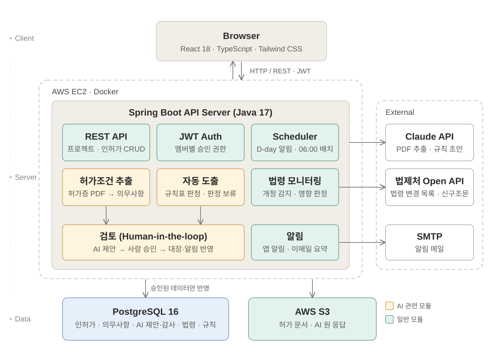

# 🌿 환경기초시설 인허가 관리 시스템


> 사기업 엔지니어링 회사의 프로젝트별 환경기초시설 인허가 생애주기를 통합 관리하는 웹 애플리케이션

---

## 👀 목차
1. [📌 프로젝트 개요](#-프로젝트-개요)
2. [📑 요구사항 분석](#-요구사항-분석)
3. [🔧 시스템 아키텍처](#-시스템-아키텍처)
4. [📋 요구사항 명세서](#-요구사항-명세서)
5. [🪧 ERD](#-erd)
6. [🗃️ 테이블 명세서](#️-테이블-명세서)
7. [🎯 API 명세서](#-api-명세서)
8. [🖥 화면 및 기능 설계서](#-화면-및-기능-설계서)
9. [🛠 기술 스택](#-기술-스택)
10. [📁 폴더 구조](#-폴더-구조)
11. [🚀 로컬 실행 방법](#-로컬-실행-방법)
12. [🗓 개발 로드맵](#-개발-로드맵)

---

## 📌 프로젝트 개요

### 📘 프로젝트 소개

**환경기초시설 인허가 관리 시스템**은 민간 엔지니어링 회사가 수행하는 환경기초시설 프로젝트의 인허가 생애주기를 통합 관리하는 웹 애플리케이션입니다.

프로젝트별로 수십 종에 달하는 인허가 항목(설치허가, 가동개시신고, 정기검사, 변경허가, 갱신허가 등)을 한 곳에서 등록·조회·관리하고, 기한 도래 시 자동 알림을 통해 허가 만료 누락을 사전에 방지합니다.

여기에 더해 **엔지니어가 법규를 손으로 검토하는 시간을 줄이는 것**을 목표로 합니다.

| 기능 | 하는 일 |
|---|---|
| **인허가 자동 도출** | 시설유형·용량·위치 등을 넣으면 필요한 인허가를 해당 사유·관련 법규와 함께 판정. 정보가 부족하면 "판정 보류"와 필요한 정보를 표시 |
| **허가조건 AI 추출** | 허가증·협의의견서 PDF에서 이행 의무(측정·보고 주기 등)를 뽑아 기한 알림에 연결 |
| **사람 검토** | AI 결과는 담당자가 원문과 대조해 승인한 것만 대장에 반영. 직급별 승인 권한 |
| **법령 개정 모니터링** | 법제처 Open API로 매일 개정을 감지해, 영향받는 인허가 담당자에게 알림 |

---

### ✅ 배경: 왜 이 서비스가 필요한가?

**반복되는 현장의 문제**

환경기초시설의 인허가는 프로젝트 착공부터 준공 이후까지 수십 종의 절차가 발생합니다. 현장에서는 이를 엑셀·종이문서·담당자 기억에 의존하여 관리하며, 아래 문제가 반복됩니다.

- 허가 만료 및 정기검사 기한 누락
- 담당자 교체 시 인허가 이력 소실
- 문서 분산 보관으로 인한 조회·제출 지연
- 법령 개정 대응 지체로 인한 행정처분 리스크

**프로젝트 기반 통합 관리의 필요성**

인허가는 시설 단위가 아닌 **프로젝트 단위**로 발생합니다. 하나의 프로젝트 안에서 인허가 유형별 진행 현황, 기한, 담당자, 첨부 문서를 한눈에 파악할 수 있는 도구가 필요합니다.

---

## 📑 요구사항 분석

### 🔐 1. 사용자 인증
- 이메일 + 비밀번호 로그인 (JWT)
- Access Token / Refresh Token 재발급
- 권한 구분: 관리자(ADMIN) / 담당자(USER)

### 📂 2. 프로젝트 관리
- 프로젝트 등록·수정·삭제 (프로젝트명, 시설 유형, 위치, 기간, 담당자)
- 프로젝트 상태 관리 (진행중 / 완료 / 보류)
- 프로젝트명·상태·담당자 기준 검색·필터

### 📋 3. 인허가 항목 관리
- 인허가 항목 등록·수정·삭제 (유형, 허가번호, 담당기관, 신청일, 취득일, 만료일)
- 진행 상태 관리 (미신청 / 신청중 / 취득완료 / 만료임박 / 만료)
- 인허가 변경 이력 자동 기록

### 🔔 4. 기한 알림
- 유효기간 만료 D-90 / D-60 / D-30 / D-7 자동 알림
- 시스템 인앱 알림 + 이메일 알림
- 알림 읽음 처리 및 목록 조회

### 📎 5. 문서 관리
- 인허가 항목별 파일 첨부 (허가증, 검사성적서, 신고서 등)
- 지원 형식: PDF / JPG / PNG / XLSX (파일당 최대 10MB)
- AWS S3 저장, 파일 다운로드·삭제

### 📅 6. 캘린더
- 인허가 기한 월별 캘린더 뷰 시각화
- 만료 임박 항목 색상 구분
- 캘린더 항목 클릭 → 인허가 상세 이동

### 📊 7. 대시보드
- 전체 프로젝트 수 / 인허가 항목 수 / 만료 임박 건수 요약
- D-30 이내 만료 임박 인허가 목록
- 인허가 상태별 현황 차트

### 🧭 8. 인허가 자동 도출
- 프로젝트 속성(시설유형·용량·위치·추진주체·신설/증설) → 필요한 인허가 목록
- 각 항목에 해당 사유("시설용량 300톤/일 ≥ 100톤/일"), 관련 법규, 승인 시점 표시
- 판정에 필요한 값이 없으면 추정하지 않고 "판정 보류" + 필요한 정보 안내
- 판정은 규칙표로 계산(같은 입력 → 같은 결과). AI는 법령 원문에서 규칙 초안을 만드는 데 사용

### 🤖 9. 허가조건 AI 추출 + 사람 검토
- 허가증·환경영향평가 협의의견서 PDF(스캔본 포함) → 이행 의무 목록
- 의무마다 원문 조건번호와 인용문 저장, 원문과 다르면 "환각 의심" 표시
- 승인 전에는 대장·알림에 반영되지 않음. 스캔본은 원문 페이지를 열어야 승인 가능
- 프로젝트 멤버별 권한: 혼자 승인 / 승인 요청만 / 일괄 승인

### ⚖️ 10. 법령 개정 모니터링
- 인허가 항목에 관련 법령(필요하면 조문까지) 연결
- 매일 06:00 법제처 Open API로 개정 감지 → 직접 영향 / 참고 분류
- 신구조문 비교, 시행일 D-day 등록, 담당자 확인 메모
- 영향 담당자에게 앱 알림 + 이메일 일일 요약

### 🔁 11. 허가증 버전 비교
- 변경허가·재협의로 새 허가증이 나오면 이전 버전과 조건별로 비교(추가 / 삭제 / 변경 / 경미)
- 숫자·주기가 바뀌면 반드시 "변경"으로 판정, 말투만 다르면 "경미"로 묶어 한 번에 처리
- 변경은 같은 의무를 고쳐 써서 이행 기록 유지, 삭제는 원문 확인 체크 후 하나씩 승인
- 대장 반영과 별도로 "현장 반영 완료"를 담당자·목표일로 추적

---

## 🔧 시스템 아키텍처



> 모듈 구성, 주요 흐름, 데이터 모델: [docs/ARCHITECTURE.md](docs/ARCHITECTURE.md)

---

## 📋 요구사항 명세서

> [요구사항 명세서](https://docs.google.com/spreadsheets/d/12-2jKy9jEzSq1YM0xmzFc1EF5N1-gAC9O7Z6JvjYeJ0/edit?hl=ko&gid=1907448249#gid=1907448249)

---

## 🪧 ERD

> [ERDCloud](https://www.erdcloud.com/d/qQKndT33McSBD2xAW)

---

## 🗃️ 테이블 명세서

> [테이블 명세서](https://github.com/user-attachments/files/28127595/table_specification.xlsx)

**기본 6개 테이블**
`users` `projects` `permit_items` `permit_history` `documents` `notifications`

확장 기능(AI 검토, 의무사항, 법령 카탈로그·개정, 판정 규칙) 테이블은 [docs/ARCHITECTURE.md](docs/ARCHITECTURE.md#5-데이터-모델-핵심)에 정리했습니다.

---

## 🎯 API 명세서

> [API 명세서](https://www.notion.so/API-368d9a463c0a80ba9200da393f864d4e?source=copy_link)

---

## 🖥 화면 및 기능 설계서

> `frontend/`에 mock 데이터로 동작하는 화면이 있습니다. 아래 [로컬 실행 방법](#-로컬-실행-방법)으로 바로 볼 수 있습니다.

| 경로 | 화면 |
|---|---|
| `/dashboard` | 대시보드 — 인허가 현황, 만료 임박 |
| `/projects`, `/projects/:id` | 프로젝트 목록·상세 — 분야별 인허가 대장, 관련 법규·승인기관 링크 |
| `/projects/new` | 새 프로젝트 — 속성 입력 → 인허가 자동 도출(판정 보류 포함) |
| `/calendar` | 인허가 일정 캘린더 |
| `/review` | 허가조건 AI 추출 결과 검토 |
| `/laws` | 법령 개정 알림 — 직접 영향 / 참고, 신구조문 비교 |

---

## 🛠 기술 스택

| 구분 | 기술 |
|------|------|
| Frontend |    |
| Backend |   |
| Database |  |
| 파일 저장 |  |
| 인프라 |   |
| 인증 |  |
| AI |  — 허가증 PDF 추출, 판정 규칙 초안 |
| 외부 데이터 | 법제처 국가법령정보 Open API — 법령 개정 감지, 신구조문 |

---

## 📁 폴더 구조

```
Environmental-License-System/
├── frontend/                   # React + TypeScript + Vite (현재 mock 데이터)
│   ├── src/
│   │   ├── pages/              # 화면 (대시보드, 프로젝트, 검토, 법령 개정 …)
│   │   ├── components/
│   │   ├── types/
│   │   └── styles/
│   └── package.json
├── backend/                    # Spring Boot (예정)
│   └── src/main/java/com/envpermit/
│       ├── core/               # 회사·프로젝트·인허가·문서
│       ├── review/             # AI 제안 검토·승인
│       ├── extraction/         # 허가증 의무 추출
│       ├── derivation/         # 인허가 자동 도출
│       ├── law/                # 법령 카탈로그·개정 감지
│       └── notification/       # 기한 알림·이메일
├── docs/
│   ├── ARCHITECTURE.md
│   └── architecture.svg
└── README.md
```

---

## 🚀 로컬 실행 방법

### 사전 준비
- Java 17+
- Node.js 20+
- Docker Desktop
- PostgreSQL 16 (또는 Docker로 실행)

### 프론트엔드 실행 (지금 바로 가능)
```bash
cd frontend
npm install
npm run dev
```
mock 데이터로 동작합니다. 로그인 화면에서 아무 이메일로나 들어갈 수 있습니다.

### 백엔드 실행 (구현 예정)
```bash
cd backend
./gradlew bootRun
```
외부 연동 키는 환경변수로만 넣습니다: `LAW_API_OC`(법제처 Open API), `ANTHROPIC_API_KEY`(Claude API).

### Docker로 전체 실행 (구현 예정)
```bash
docker-compose up -d
```

---

## 🗓 개발 로드맵

| 단계 | 작업 내용 | 상태 |
|------|----------|------|
| 1 | 화면 설계 · mock 프론트엔드 (대시보드, 프로젝트, 캘린더, 검토, 법령 개정, 자동 도출) | ✅ 완료 |
| 2 | 확장 기능 설계: 사람 검토 + 허가조건 추출, 법령 개정 모니터링 | ✅ 설계 승인 |
| 3 | 확장 기능 설계: 인허가 자동 도출 엔진, 허가증 버전 비교 | ✅ 설계 승인 |
| 4 | 앱 뼈대: 인증, 프로젝트·인허가 CRUD, 문서 첨부, 기한 알림 | ⏳ 예정 |
| 5 | 사람 검토 + 허가조건 AI 추출 | ⏳ 예정 |
| 6 | 법령 개정 모니터링 (법제처 Open API) | ⏳ 예정 |
| 7 | 인허가 자동 도출 엔진 · 허가증 버전 비교 | ⏳ 예정 |
| 8 | 배포 (Docker → AWS EC2) | ⏳ 예정 |

---

## 📄 License

[MIT](./LICENSE)
