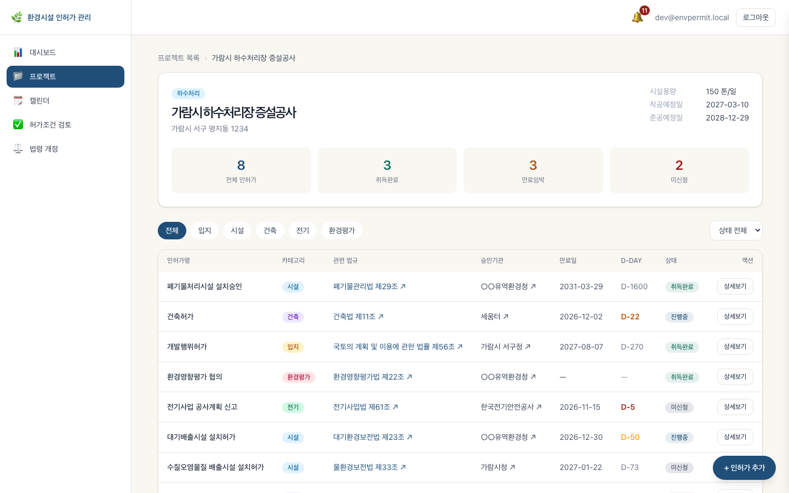
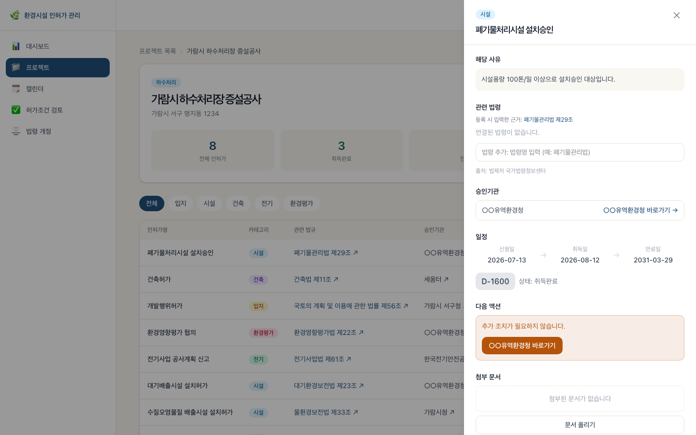
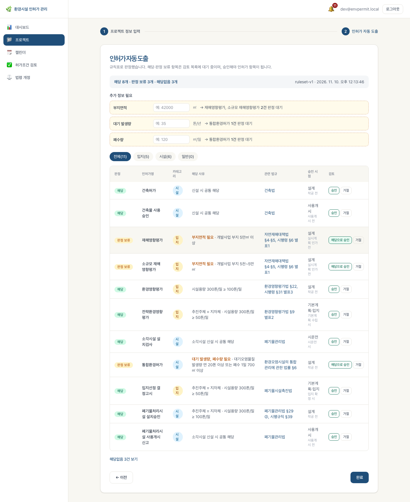
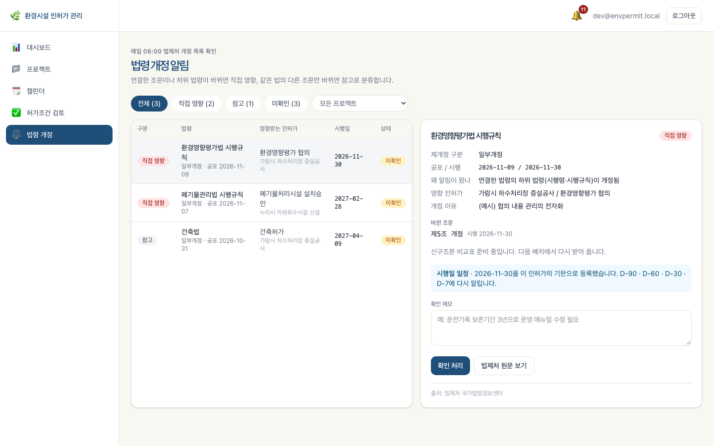

# 🌿 환경기초시설 인허가 관리 시스템


> 사기업 엔지니어링 회사의 프로젝트별 환경기초시설 인허가 생애주기를 통합 관리하는 웹 애플리케이션

---

## ✅ 지금 동작하는 것

백엔드(Spring Boot)와 화면(React)이 실제 API로 연결돼 있고, 로컬에서 `docker compose` + `npm run dev`로 띄워 볼 수 있습니다. 백엔드 테스트는 Testcontainers로 실제 PostgreSQL 위에서 돌립니다(2026-11-10 `dev` 기준 413개 통과, 실제 API 녹화용 2개는 건너뜀). 아직 배포하지 않았고, 정확도 평가(정답셋)는 만들지 않았습니다. 자세한 구분은 [개발 로드맵](#-개발-로드맵)에 있습니다.

| 기능 | 상태 | 테스트 (`backend/src/test/java/com/envpermit/…`) |
|---|---|---|
| 로그인(JWT, 토큰 재발급), 회사·프로젝트·멤버 권한, 인허가 항목 CRUD·상태 이력 | ✅ API · 화면 (인허가 추가·수정 폼은 아직 없음) | `core/auth/AuthApiTest`, `core/project/ProjectPermitApiTest` |
| 인허가 문서 첨부 (S3, 형식·용량·내용 검사) | ✅ | `core/document/DocumentApiTest`, `DocumentTypeTest` |
| 기한 알림 D-90/60/30/7, 앱 알림, 캘린더 | ✅ (이메일은 로그로만 남김, 실제 발송 없음) | `notification/NotificationApiTest` |
| 법령 카탈로그 · 인허가↔법령 연결 · 법제처 검색 | ✅ | `law/LawApiTest`, `law/LawApiClientTest` |
| 매일 법령 개정 감지 배치 · 직접 영향/참고 판정 · 개정 알림 화면 | ✅ (테스트는 법제처 응답 픽스처로) | `law/AmendmentBatchTest`, `AmendmentFilterTest`, `ImpactRuleTest`, `LawImpactApiTest` |
| 사람 검토 통로 (승인·승인 요청·거절, 일괄 승인, 감사 로그) | ✅ | `review/ReviewApiTest`, `review/TransitionTest` |
| 허가조건 AI 추출 (텍스트 PDF, 인용문 원문 대조, 스캔본은 원문 페이지 열람 후 승인) | ✅ (스캔본 OCR은 없음) | `extraction/ExtractionApiTest`, `QuoteCheckerTest`, `CitationKeyTest` |
| 추출 제공자 Claude / Gemini / OpenAI 선택 | ✅ (Gemini·OpenAI는 실제 API 응답을 녹화해 테스트, Claude는 손으로 만든 응답) | `extraction/GeminiClientTest`, `OpenAiClientTest`, `ProviderTest` |
| 의무사항 승인 시 근거 법령 자동 연결 | ✅ | `obligation/ObligationLawLinkApiTest`, `law/LegalBasisTest` |
| 인허가 자동 도출 (규칙 엔진 참/거짓/모름, 판정 보류, 승인, 재실행) | ✅ (규칙은 시드 SQL, AI 규칙 초안은 없음) | `derivation/EvaluatorTest`, `DerivationApiTest`, `DerivationReviewApiTest`, `RerunTest` |
| 허가증 버전 비교 (추가/삭제/변경/경미), 승인, 현장 반영 추적 | ✅ | `revision/DiffEngineTest`, `extraction/RevisionApiTest`, `RevisionApplyApiTest` |
| 대시보드 | 🟡 기한 임박·현장 반영 대기는 실제 API, **상태 분포 차트·최근 활동은 아직 mock** | — |

> 로그인 화면의 "카카오 로그인" 버튼은 자리만 있고 동작하지 않습니다.

### 화면

아래는 로컬에서 띄운 실제 화면입니다. 회사·프로젝트·법령 개정 내역은 `dev` 프로필이 넣는 **가상의 예시 데이터**입니다.

| 프로젝트 상세 — 분야별 인허가 대장 | 인허가 상세 — 해당 사유, 관련 법령, 문서 |
|---|---|
|  |  |
| **인허가 자동 도출 — 해당 / 판정 보류 + 필요한 정보** | **법령 개정 알림 — 직접 영향 / 참고** |
|  |  |

---

## 👀 목차
0. [✅ 지금 동작하는 것](#-지금-동작하는-것)
1. [📌 프로젝트 개요](#-프로젝트-개요)
2. [📑 요구사항 분석](#-요구사항-분석)
3. [🔧 시스템 아키텍처](#-시스템-아키텍처)
4. [📋 요구사항 명세서](#-요구사항-명세서)
5. [🪧 ERD](#-erd)
6. [🗃️ 테이블 명세서](#️-테이블-명세서)
7. [🎯 API 명세서](#-api-명세서)
8. [🖥 화면 및 기능 설계서](#-화면-및-기능-설계서)
9. [🛠 기술 스택](#-기술-스택)
10. [📁 폴더 구조](#-폴더-구조)
11. [🚀 로컬 실행 방법](#-로컬-실행-방법)
12. [🗓 개발 로드맵](#-개발-로드맵)

---

## 📌 프로젝트 개요

### 📘 프로젝트 소개

**환경기초시설 인허가 관리 시스템**은 민간 엔지니어링 회사가 수행하는 환경기초시설 프로젝트의 인허가 생애주기를 통합 관리하는 웹 애플리케이션입니다.

프로젝트별로 수십 종에 달하는 인허가 항목(설치허가, 가동개시신고, 정기검사, 변경허가, 갱신허가 등)을 한 곳에서 등록·조회·관리하고, 기한 도래 시 자동 알림을 통해 허가 만료 누락을 사전에 방지합니다.

여기에 더해 **엔지니어가 법규를 손으로 검토하는 시간을 줄이는 것**을 목표로 합니다.

| 기능 | 하는 일 |
|---|---|
| **인허가 자동 도출** | 시설유형·용량·위치 등을 넣으면 필요한 인허가를 해당 사유·관련 법규와 함께 판정. 정보가 부족하면 "판정 보류"와 필요한 정보를 표시 |
| **허가조건 AI 추출** | 허가증·협의의견서 PDF에서 이행 의무(측정·보고 주기 등)를 뽑아 기한 알림에 연결 |
| **사람 검토** | AI 결과는 담당자가 원문과 대조해 승인한 것만 대장에 반영. 직급별 승인 권한 |
| **법령 개정 모니터링** | 법제처 Open API로 매일 개정을 감지해, 영향받는 인허가 담당자에게 알림 |

---

### ✅ 배경: 왜 이 서비스가 필요한가?

**반복되는 현장의 문제**

환경기초시설의 인허가는 프로젝트 착공부터 준공 이후까지 수십 종의 절차가 발생합니다. 현장에서는 이를 엑셀·종이문서·담당자 기억에 의존하여 관리하며, 아래 문제가 반복됩니다.

- 허가 만료 및 정기검사 기한 누락
- 담당자 교체 시 인허가 이력 소실
- 문서 분산 보관으로 인한 조회·제출 지연
- 법령 개정 대응 지체로 인한 행정처분 리스크

**프로젝트 기반 통합 관리의 필요성**

인허가는 시설 단위가 아닌 **프로젝트 단위**로 발생합니다. 하나의 프로젝트 안에서 인허가 유형별 진행 현황, 기한, 담당자, 첨부 문서를 한눈에 파악할 수 있는 도구가 필요합니다.

---

## 📑 요구사항 분석

### 🔐 1. 사용자 인증
- 이메일 + 비밀번호 로그인 (JWT)
- Access Token / Refresh Token 재발급
- 권한 구분: 관리자(ADMIN) / 담당자(USER)

### 📂 2. 프로젝트 관리
- 프로젝트 등록·수정·삭제 (프로젝트명, 시설 유형, 위치, 기간, 담당자)
- 프로젝트 상태 관리 (진행중 / 완료 / 보류)
- 프로젝트명·상태·담당자 기준 검색·필터

### 📋 3. 인허가 항목 관리
- 인허가 항목 등록·수정·삭제 (유형, 허가번호, 담당기관, 신청일, 취득일, 만료일)
- 진행 상태 관리 (미신청 / 신청중 / 취득완료 / 만료임박 / 만료)
- 인허가 변경 이력 자동 기록

### 🔔 4. 기한 알림
- 유효기간 만료 D-90 / D-60 / D-30 / D-7 자동 알림
- 시스템 인앱 알림 + 이메일 알림
- 알림 읽음 처리 및 목록 조회

### 📎 5. 문서 관리
- 인허가 항목별 파일 첨부 (허가증, 검사성적서, 신고서 등)
- 지원 형식: PDF / JPG / PNG / XLSX (파일당 최대 10MB)
- AWS S3 저장, 파일 다운로드·삭제

### 📅 6. 캘린더
- 인허가 기한 월별 캘린더 뷰 시각화
- 만료 임박 항목 색상 구분
- 캘린더 항목 클릭 → 인허가 상세 이동

### 📊 7. 대시보드
- 전체 프로젝트 수 / 인허가 항목 수 / 만료 임박 건수 요약
- D-30 이내 만료 임박 인허가 목록
- 인허가 상태별 현황 차트

### 🧭 8. 인허가 자동 도출
- 프로젝트 속성(시설유형·용량·위치·추진주체·신설/증설) → 필요한 인허가 목록
- 각 항목에 해당 사유("시설용량 300톤/일 ≥ 100톤/일"), 관련 법규, 승인 시점 표시
- 판정에 필요한 값이 없으면 추정하지 않고 "판정 보류" + 필요한 정보 안내
- 판정은 규칙표로 계산(같은 입력 → 같은 결과). AI는 법령 원문에서 규칙 초안을 만드는 데 사용

### 🤖 9. 허가조건 AI 추출 + 사람 검토
- 허가증·환경영향평가 협의의견서 PDF(스캔본 포함) → 이행 의무 목록
- 의무마다 원문 조건번호와 인용문 저장, 원문과 다르면 "환각 의심" 표시
- 승인 전에는 대장·알림에 반영되지 않음. 스캔본은 원문 페이지를 열어야 승인 가능
- 프로젝트 멤버별 권한: 혼자 승인 / 승인 요청만 / 일괄 승인

### ⚖️ 10. 법령 개정 모니터링
- 인허가 항목에 관련 법령(필요하면 조문까지) 연결
- 매일 06:00 법제처 Open API로 개정 감지 → 직접 영향 / 참고 분류
- 신구조문 비교, 시행일 D-day 등록, 담당자 확인 메모
- 영향 담당자에게 앱 알림 + 이메일 일일 요약

### 🔁 11. 허가증 버전 비교
- 변경허가·재협의로 새 허가증이 나오면 이전 버전과 조건별로 비교(추가 / 삭제 / 변경 / 경미)
- 숫자·주기가 바뀌면 반드시 "변경"으로 판정, 말투만 다르면 "경미"로 묶어 한 번에 처리
- 변경은 같은 의무를 고쳐 써서 이행 기록 유지, 삭제는 원문 확인 체크 후 하나씩 승인
- 대장 반영과 별도로 "현장 반영 완료"를 담당자·목표일로 추적

---

## 🔧 시스템 아키텍처


> 모듈 구성, 주요 흐름, 데이터 모델: [docs/ARCHITECTURE.md](docs/ARCHITECTURE.md)

---

## 📋 요구사항 명세서

> [요구사항 명세서](https://docs.google.com/spreadsheets/d/12-2jKy9jEzSq1YM0xmzFc1EF5N1-gAC9O7Z6JvjYeJ0/edit?hl=ko&gid=1907448249#gid=1907448249)

---

## 🪧 ERD

> [ERDCloud](https://www.erdcloud.com/d/qQKndT33McSBD2xAW)

---

## 🗃️ 테이블 명세서

> [테이블 명세서](https://github.com/user-attachments/files/28127595/table_specification.xlsx)

**기본 6개 테이블**
`users` `projects` `permit_items` `permit_history` `documents` `notifications`

확장 기능(AI 검토, 의무사항, 법령 카탈로그·개정, 판정 규칙) 테이블은 [docs/ARCHITECTURE.md](docs/ARCHITECTURE.md#5-데이터-모델-핵심)에 정리했습니다.

---

## 🎯 API 명세서

> [API 명세서](https://www.notion.so/API-368d9a463c0a80ba9200da393f864d4e?source=copy_link)

---

## 🖥 화면 및 기능 설계서

> 화면은 실제 API에 연결돼 있습니다(대시보드 일부 제외). 아래 [로컬 실행 방법](#-로컬-실행-방법)으로 볼 수 있습니다.

| 경로 | 화면 | 데이터 |
|---|---|---|
| `/dashboard` | 대시보드 — 인허가 현황, 만료 임박 | 🟡 기한 임박·현장 반영 대기는 API, 상태 분포 차트·최근 활동은 mock |
| `/projects`, `/projects/:id` | 프로젝트 목록·상세 — 분야별 인허가 대장, 관련 법령, 문서, 버전 비교 | API (인허가 추가 버튼은 아직 동작하지 않음) |
| `/projects/new` | 새 프로젝트 — 속성 입력 → 인허가 자동 도출(판정 보류 포함) | API |
| `/calendar` | 인허가 일정 캘린더 | API |
| `/review` | 허가조건 AI 추출 결과 검토 | API |
| `/laws` | 법령 개정 알림 — 직접 영향 / 참고, 신구조문 비교 | API |

---

## 🛠 기술 스택

| 구분 | 기술 |
|------|------|
| Frontend |    |
| Backend |   |
| Database |  |
| 파일 저장 |  |
| 인프라 |   |
| 인증 |  |
| AI | Claude / Gemini / OpenAI 중 하나 (서버 설정) — 허가증 PDF 의무사항 추출 |
| 외부 데이터 | 법제처 국가법령정보 Open API — 법령 개정 감지, 신구조문 |

---

## 📁 폴더 구조

```
Environmental-License-System/
├── frontend/                   # React + TypeScript + Vite
│   ├── src/
│   │   ├── api/                # 백엔드 API 호출
│   │   ├── pages/              # 화면 (대시보드, 프로젝트, 검토, 법령 개정 …)
│   │   ├── components/
│   │   ├── types/
│   │   └── styles/
│   └── package.json
├── backend/                    # Spring Boot 3 + Flyway
│   └── src/main/java/com/envpermit/
│       ├── core/               # 인증·회사·프로젝트·인허가·문서
│       ├── review/             # AI 제안 검토·승인
│       ├── extraction/         # 허가증 의무 추출 (Claude / Gemini / OpenAI)
│       ├── obligation/         # 의무사항·버전 반영·현장 반영
│       ├── revision/           # 허가증 버전 비교
│       ├── derivation/         # 인허가 자동 도출
│       ├── law/                # 법령 카탈로그·개정 감지·영향 판정
│       └── notification/       # 기한 알림·이메일(현재 로그)
├── docs/
│   ├── ARCHITECTURE.md
│   ├── architecture.svg
│   └── images/                 # README 화면 캡처
└── README.md
```

---

## 🚀 로컬 실행 방법

### 사전 준비
- Docker Desktop
- Node.js 20+
- Java 17 (백엔드를 Docker 없이 실행하거나 테스트할 때)

### 1. 환경변수 (`.env`)
비밀값(DB 비밀번호, JWT 키, 외부 API 키)은 환경변수로만 받습니다. `.env`는 git에 올라가지 않습니다.
```bash
cp .env.example .env
```
`.env`를 열어 `DB_PASSWORD`, `JWT_SECRET`(32바이트 이상, 예: `openssl rand -base64 48` 결과), `S3_SECRET_KEY`를 채웁니다.
법제처 검색(관련 법령 추가)을 쓰려면 `LAW_API_OC`에 법제처 Open API OC를 넣습니다. 비워 두면 그 기능만 503을 돌려주고, 시드 법령 카탈로그와 연결은 그대로 동작합니다.

**허가조건 AI 추출 제공자 (Claude / Gemini / OpenAI)** — 서버당 하나를 씁니다.

| 환경변수 | 내용 |
|---|---|
| `EXTRACTION_PROVIDER` | `claude`, `gemini`, `openai` 중 하나. 비우면 키가 있는 쪽(여럿이면 Claude → Gemini → OpenAI 순) |
| `ANTHROPIC_API_KEY` / `GEMINI_API_KEY` / `OPENAI_API_KEY` | API 키. 이 환경변수로만 받고 설정 파일·로그·응답 저장본에는 남기지 않습니다 |
| `CLAUDE_MODEL` / `GEMINI_MODEL` / `OPENAI_MODEL` | 모델 id (기본 `claude-sonnet-5-5` / `gemini-3.6-flash` / `gpt-6.1-terra`). PDF 입력과 구조화 출력(JSON 스키마)을 지원하는 모델이어야 합니다 |

회사 설정에서 마스터가 AI 추출을 켜야 실행되며, 실행 전 고지에 선택된 제공자 이름이 나옵니다. 실행마다 제공자·모델·프롬프트 버전·토큰 수가 `ai_run`에 남습니다. 제공자별 추출 품질은 수동 평가 스크립트로 잽니다([docs/EXTRACTION_EVAL.md](docs/EXTRACTION_EVAL.md)).

> ⚠️ **Gemini 무료 등급은 입력·응답을 Google 제품 개선에 쓸 수 있습니다.** 실제 회사 문서는 결제 계정이 연결된 유료 등급(학습 미사용)에서만 보내세요. 약관은 바뀔 수 있으니 [Gemini API 추가 약관](https://ai.google.dev/gemini-api/terms)을 직접 확인하세요. Claude·OpenAI도 마찬가지로 [Anthropic 약관](https://www.anthropic.com/legal)·[OpenAI 데이터 정책](https://openai.com/enterprise-privacy/)의 데이터 사용·보존 조건을 확인하세요. OpenAI 호출은 `store: false`로 보냅니다.

**메일 (Gmail SMTP)** — `SMTP_HOST`가 있으면 실제로 보내고, 비우면 로그에만 남깁니다(`LogMailer`). 가입 요청·결과, 기한 알림, 법령 개정 메일이 모두 같은 발송기를 씁니다.
1. 보낼 Gmail 계정에서 [2단계 인증](https://myaccount.google.com/signinoptions/two-step-verification)을 켭니다.
2. [앱 비밀번호](https://myaccount.google.com/apppasswords)에서 앱 비밀번호(16자)를 만듭니다. 계정 비밀번호는 쓰지 않습니다.
3. `.env`에 채웁니다:
   ```
   SMTP_HOST=smtp.gmail.com
   SMTP_PORT=587            # STARTTLS
   SMTP_USERNAME=you@gmail.com
   SMTP_PASSWORD=앱비밀번호16자
   SMTP_FROM=               # 비우면 SMTP_USERNAME
   APP_BASE_URL=http://localhost:5182   # 메일 속 링크가 가리킬 웹 주소
   ```

### 2. DB + API 실행 (Docker)
```bash
docker compose up -d --build
```
- PostgreSQL 16(`localhost:5432`), 문서 저장소(S3 호환 SeaweedFS, `localhost:8333`), API(`localhost:8080`)가 뜹니다. Flyway가 스키마를 만들고, API가 시작할 때 버킷을 만듭니다.
- 포트가 이미 쓰이고 있으면 바꿔서 띄웁니다: `DB_PORT=15432 API_PORT=18080 docker compose up -d --build`
- `SPRING_PROFILES_ACTIVE=dev`(기본값)이면 개발용 계정과 가상의 예시 데이터(회사·프로젝트·인허가)가 생깁니다. 로컬 전용, 운영 프로필에서는 만들어지지 않습니다. 비밀번호는 모두 `dev1234!`
  - **dev@envpermit.local** — A사 회사 관리자, 예시 프로젝트 4개의 생성자(어드민)
  - kim@envpermit.local — A사, 프로젝트 1의 일반 멤버(승인 권한 없음)
  - other@envpermit.local — B사. A사 프로젝트에 들어가면 403

### 3. 프론트엔드 실행
```bash
cd frontend
npm install
npm run dev
```
`/api` 요청은 Vite가 `http://localhost:8080`으로 넘깁니다. API 포트를 바꿨다면 `API_URL=http://localhost:18080 npm run dev`.
로그인 화면에서 위 개발용 계정으로 로그인합니다. 대시보드의 상태 분포 차트·최근 활동만 mock이고, 나머지 화면은 실제 API를 씁니다.

### 백엔드만 Docker 없이 실행
DB와 문서 저장소는 `docker compose up -d db s3`로 띄우고:
```bash
cd backend
set -a; . ../.env; set +a
S3_ENDPOINT=http://localhost:8333 ./gradlew bootRun
```
DB 포트를 바꿨다면 `DB_URL=jdbc:postgresql://localhost:15432/envpermit ./gradlew bootRun`.

### 테스트
```bash
cd backend
./gradlew test
```
Docker가 켜져 있어야 합니다. Testcontainers가 PostgreSQL 16 컨테이너를 띄워 실제 DB 위에서 API를 검증합니다. 문서 저장소는 테스트에서 메모리 가짜로 바꿉니다.

### 인증 API
| 메서드 | 경로 | 설명 |
|---|---|---|
| POST | `/api/auth/login` | `{email, password}` → `{accessToken, refreshToken, user}`. 실패 시 401 `{message}` |
| POST | `/api/auth/refresh` | `{refreshToken}` → 새 토큰 쌍 |
| GET | `/api/me` | `Authorization: Bearer <accessToken>` → 내 정보 |

Access 토큰 30분, Refresh 토큰 14일.

### 회원가입 API
| 메서드 | 경로 | 설명 |
|---|---|---|
| POST | `/api/auth/signup` | 새 회사 `{companyName, name, email, password}` → 회사 + 회사 관리자 계정, 바로 로그인 토큰 |
| GET | `/api/auth/invite/{code}` | 초대 코드의 회사명 (없으면 404) |
| POST | `/api/auth/join` | 가입 신청 `{code, name, email, password}` → 202. 승인 전에는 로그인 401(대기 안내) |
| GET/POST | `/api/company/invite-code` | 회사 관리자: 초대 코드 보기 / 재발급(옛 코드 즉시 무효) |
| GET | `/api/join-requests` | 회사 관리자: 대기 중 신청 |
| POST | `/api/join-requests/{id}/approve` · `/reject` `{reason}` | 회사 관리자: 승인(계정 생성 + 회사 합류) / 거절. 다른 회사면 403 |

- 회사 관리자 = `users.role = ADMIN`. 새 회사를 만든 사람이 첫 관리자입니다.
- 신청하면 그 회사 관리자 전원에게 메일(`/join-requests` 링크)과 앱 알림이 갑니다. 한 명이 처리하면 끝나고, 신청자에게 결과 메일이 갑니다.
- 이메일 중복 불가, 비밀번호 8자 이상, 대기 신청은 14일 후 만료, 같은 코드·IP는 10분에 3건까지.

### 기한 알림 API
| 메서드 | 경로 | 설명 |
|---|---|---|
| GET | `/api/deadlines?from=YYYY-MM-DD&to=YYYY-MM-DD` | 내가 속한 프로젝트의 기한 일정(최대 1년 범위) |
| GET | `/api/notifications` | 내 알림 최신 50건 |
| POST | `/api/notifications/{id}/read` | 읽음 처리 (남의 알림이면 404) |
| POST | `/api/notifications/read-all` | 모두 읽음 |

- 다른 모듈은 `Deadlines.register(kind, targetId, projectId, title, dueDate, assigneeId)`로 기한을 등록합니다. 인허가 만료일은 자동 등록됩니다(`PERMIT_EXPIRY`).
- 매일 07:00(서버 시작 시에도 한 번) D-90/60/30/7 앱 알림을 만들고, 사용자별 이메일 요약을 1통 보냅니다. 같은 일정·D-day 알림은 다시 만들지 않습니다.
- 메일은 `SMTP_*`가 있으면 실제 발송, 없으면 로그(`LogMailer`). 위 '메일 (Gmail SMTP)' 참고.

### 문서 첨부 API
프로젝트 멤버만 쓸 수 있습니다(아니면 403). 경로 앞부분은 `/api/projects/{projectId}/permits/{permitId}/documents`.

| 메서드 | 경로 | 설명 |
|---|---|---|
| GET | `…/documents` | 목록 (최신순, SHA-256 해시 포함) |
| POST | `…/documents` | `multipart/form-data`의 `file`. PDF/JPG/PNG/XLSX, 10MB 이하. 확장자와 파일 내용이 모두 맞아야 합니다. 아니면 400/413 `{message}` |
| GET | `…/documents/{id}` | 내려받기 |
| DELETE | `…/documents/{id}` | 삭제 (저장소의 파일도 지움) |

---

## 🗓 개발 로드맵

✅ 구현(테스트 있음) · 🟡 부분 구현 · ⏳ 미구현. PR 번호는 `dev` 브랜치에 병합된 PR입니다.

| 단계 | 작업 내용 | 상태 |
|------|----------|------|
| 1 | 화면 설계 · 프론트엔드 초안 | ✅ (#1) |
| 2–3 | 확장 기능 설계: 사람 검토 + 허가조건 추출, 법령 개정 모니터링, 자동 도출, 버전 비교 | ✅ 설계 승인 (#2, #3) |
| 4 | 앱 뼈대: 인증, 회사·프로젝트·멤버 권한, 인허가 CRUD, 문서 첨부, 기한 알림 | ✅ (#4–#7) · 🟡 이메일은 로그로만, 화면의 인허가 추가·수정 폼 없음 |
| 5 | 사람 검토 + 허가조건 AI 추출 (텍스트 PDF, 스캔본 원문 열람 승인, 일괄 승인, Claude/Gemini/OpenAI) | ✅ (#9, #12, #13, #18, #20) · 🟡 스캔본 OCR 없음, Claude 실제 응답 미검증 |
| 6 | 법령 개정 모니터링 (카탈로그, 매일 개정 감지, 영향 판정, 의무–법령 연결) | ✅ (#8, #10, #14, #15) |
| 7a | 인허가 자동 도출 (규칙 엔진, 판정 승인, 재실행) | ✅ (#11, #16) · ⏳ AI 규칙 초안·규칙 관리자 승인 없음(규칙은 시드 SQL) |
| 7b | 허가증 버전 비교 (비교 엔진, 승인, 현장 반영 추적) | ✅ (#17, #19, #21) |
| 7c | 자동 도출 정확도 평가 (정답셋으로 재현율·정밀도) | ⏳ 미구현 |
| — | 대시보드 상태 분포 차트·최근 활동 | 🟡 mock |
| — | 실제 이메일 발송 (SMTP) | ⏳ 미구현 (`LogMailer`가 로그로만 남김) |
| — | CI (GitHub Actions) | ⏳ 미구현 |
| 8 | 배포 (Docker → AWS EC2) | ⏳ 미구현 |

---

## 📄 License

[MIT](./LICENSE)
