# 🌿 환경기초시설 인허가 관리 시스템


[](https://github.com/Dawit-lee/Environmental-License-System/actions/workflows/ci.yml)


> 설계·엔지니어링 회사가 소각·하수·바이오가스 같은 환경기초시설 프로젝트의 인허가를 **도출 → 진행·기한 관리 → 협의의견·허가조건 반영 → 법령 개정 대응**까지 프로젝트 단위로 관리하는 웹 애플리케이션

---

## 왜 만들었나

환경기초시설 설계 한 건에는 인허가가 수십 건 걸립니다. 어떤 인허가가 필요한지는 엔지니어가 시설용량·부지면적·공사비·용도지역 같은 사업 속성을 법령 기준과 하나씩 대조해 엑셀 검토서로 정리하고, 진행 상황과 기한은 엑셀·공문·담당자 기억에 나뉘어 있습니다. 협의의견서와 허가증의 조건은 사람이 읽어 설계에 반영했는지 따로 챙겨야 하고, 법령이 바뀌면 어느 프로젝트의 어느 인허가에 영향이 있는지 다시 훑어야 합니다. 이 앱은 그 과정을 프로젝트 하나에 모으고, AI와 규칙 엔진이 **제안**을 만들면 담당자가 원문과 대조해 **승인한 것만** 대장에 반영하도록 만든 것입니다.

> 개인 포트폴리오 프로젝트입니다. 저장소의 회사·프로젝트·지명·인물은 모두 가상의 이름이고, 실제 회사 문서와 실제 사업 데이터는 저장소에 없습니다([기밀 처리](docs/ARCHITECTURE.md#8-기밀-데이터-처리)).

---

## 기능

### 핵심

| 기능 | 하는 일 | 상태 |
|---|---|---|
| **인허가 자동 도출** | 시설유형·용량·위치·추진주체·신설/증설 등 속성을 넣으면 필요한 인허가를 해당 사유("시설용량 300톤/일 ≥ 100톤/일")·근거 법령과 함께 판정. 값이 없으면 추정하지 않고 **판정 보류** + 필요한 정보 표시. 결과는 검토·승인 후 대장에 반영, 속성이 바뀌면 재실행 | ✅ 규칙 51개(시드 SQL). AI 규칙 초안은 미구현 |
| **인허가 진행·기한 관리** | 프로젝트별 인허가 대장(분야·상태·이력), 문서 첨부, D-90/60/30/7 기한 알림, 내 할 일, 대시보드 | ✅ |
| **협의의견·허가조건 AI 추출 + 사람 검토** | 협의의견서·허가증 PDF에서 이행 조건을 조건번호·인용문과 함께 추출. 인용문을 원문과 대조해 다르면 "환각 의심"으로 맨 위에. 승인·수정 후 승인·승인 요청·거절, 일괄 승인, 감사 로그. 제공자 Claude / Gemini / OpenAI 중 서버당 하나 | ✅ 텍스트 PDF. 스캔본은 OCR 없이 원문 페이지 열람 후 승인 |
| **허가증·협의의견 버전 비교** | 변경허가·재협의로 새 판이 나오면 이전 판과 조건별로 비교(추가/삭제/변경/경미). 숫자·주기가 바뀌면 반드시 "변경". 승인 후 "현장 반영" 담당·목표일 추적 | ✅ |
| **법령 개정 알림** | 인허가에 법령(필요하면 조문까지) 연결. 매일 법제처 Open API로 개정을 감지해 직접 영향 / 참고로 나누고, 신구조문 비교·시행일 기한 등록·확인 메모 | ✅ |
| **프로젝트 중심 구조** | 프로젝트 화면의 탭(개요·인허가·의무사항·AI 검토·법령 영향·일정·문서·설정), 회사·부서·팀, 프로젝트별 PM·EM, 멤버별 승인 권한 | ✅ |
| **분야별 설계 일정** | 분야별 일정 항목·마일스톤·선후행(FS) 간트, 기준일·오프셋과 기준 확정·지연 계산, 이벤트·출장(프로젝트·회사 달력), 협력사 읽기 전용 공유(링크·ICS·인쇄본), 선택형 Google 캘린더 단방향 동기화, 문서 → 일정 제안(AI 제안 + 사람 검토), 인허가 진행 현황 1쪽(XLSX) | ✅ Google 동기화는 실제 Google 호출 전 |

### 선택 모듈

| 기능 | 하는 일 | 상태 |
|---|---|---|
| 운영단계 관리 | 배출구·허가 한도, 측정값 입력·판정, 초과 시 조치 업무, 이행 보고서 초안(XLSX). 운영사 업무라 **프로젝트별로 켜는 선택 모듈이며 기본은 꺼짐** | ✅ (꺼짐이 기본) |

그 밖에: 이메일+비밀번호 로그인(JWT), 새 회사 가입 / 초대 코드로 가입 신청 → 회사 관리자 승인, Gmail SMTP 메일(설정이 없으면 로그로만).

---

## 화면

모두 `dev` 프로필의 가상 데이터로 찍었습니다(2026-11-16, 1440×900).

- [x] 프로젝트 개요 탭 (`/projects/:id/overview`) — 단계, 처리 대기, 기한
- [x] 인허가 탭 — 분야별 대장 + 인허가 상세 드로어(해당 사유·관련 법령·문서)
- [x] 새 프로젝트 → 인허가 자동 도출 결과 (해당 / 판정 보류 + 추가 정보 필요)
- [x] AI 검토 탭 — 환각 의심 표시, 인용문, 승인 버튼(권한별)
- [x] 버전 비교 화면 — 추가/삭제/변경/경미
- [x] 법령 영향 탭 — 직접 영향 / 참고, 신구조문
- [x] 일정 탭 — 간트(분야 묶음, 선후행 선, 오늘 선)
- [x] 내 할 일 (`/inbox`)

**프로젝트 개요** — 단계, 인허가 집계, 규제 대응 현황

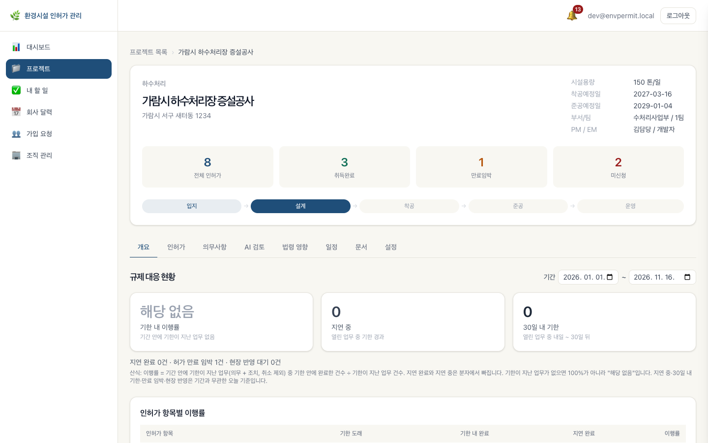

**인허가 탭** — 분야별 대장, `진행 현황 보고 ⬇` 버튼(XLSX 1쪽 보고)

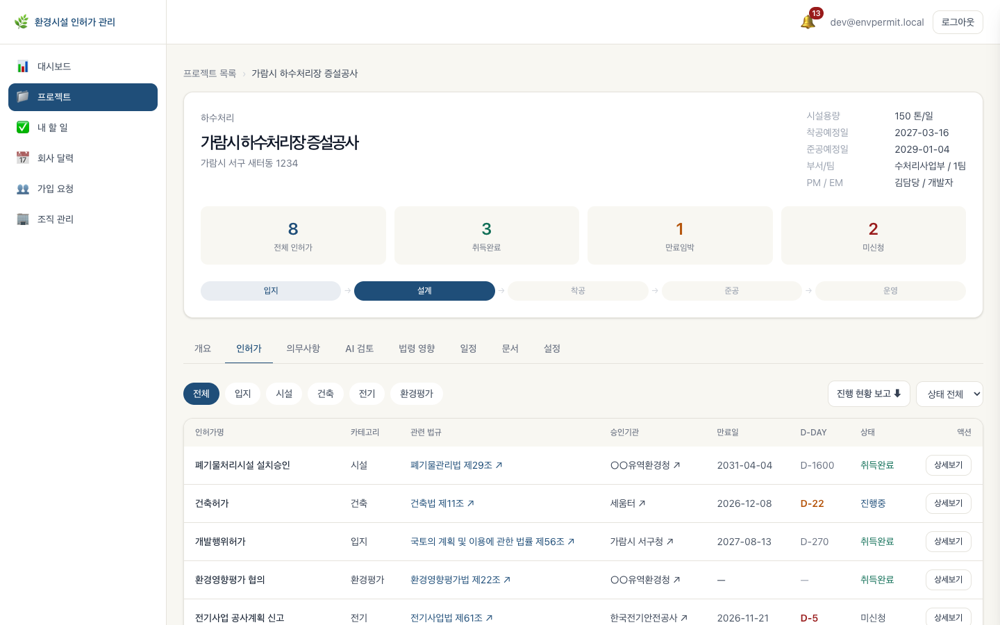

**인허가 상세 드로어** — 해당 사유, 관련 법령, 승인기관, 일정

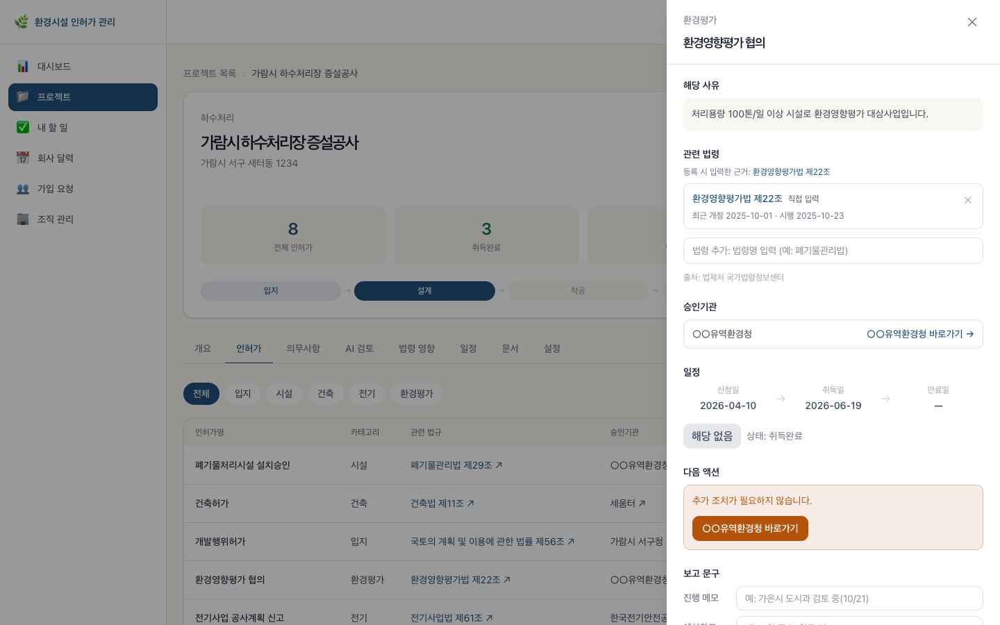

**새 프로젝트 → 인허가 자동 도출** — 해당 / 판정 보류, 추가 정보 필요

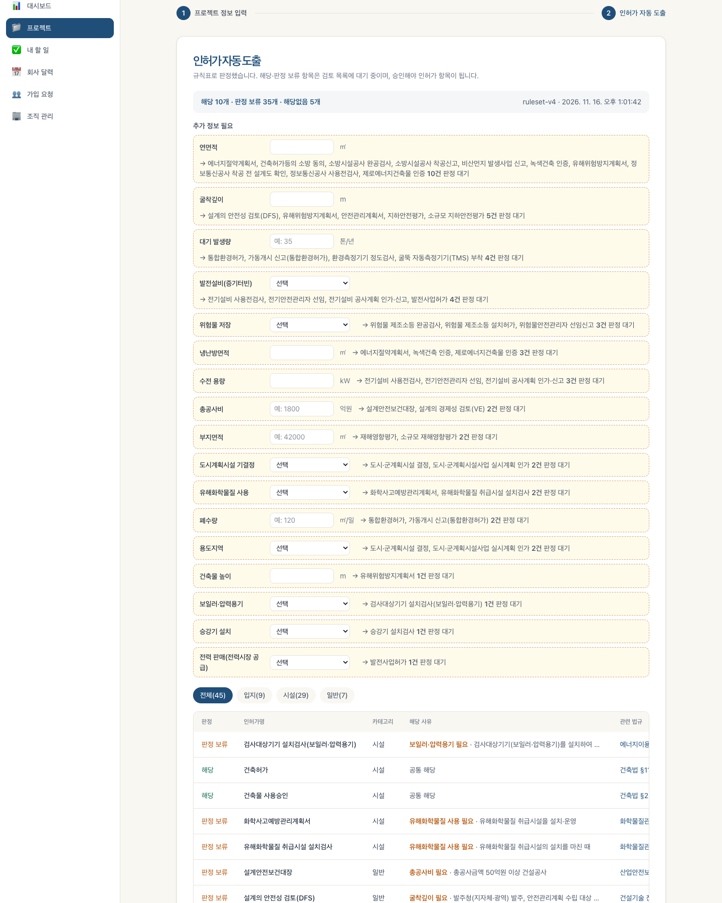

**AI 검토** — 원문 불일치(환각 의심) 표시, 원문 인용, 승인·거절·수정

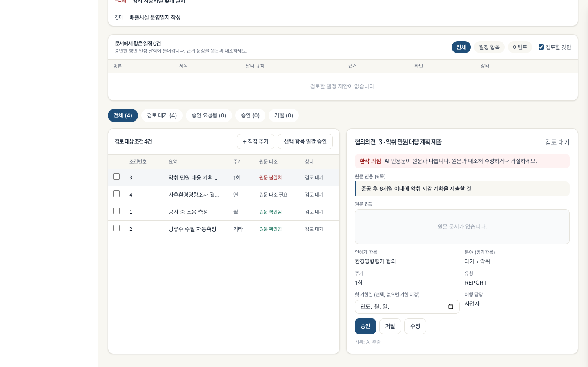

**버전 비교** — 변경/삭제/경미, 숫자 변화

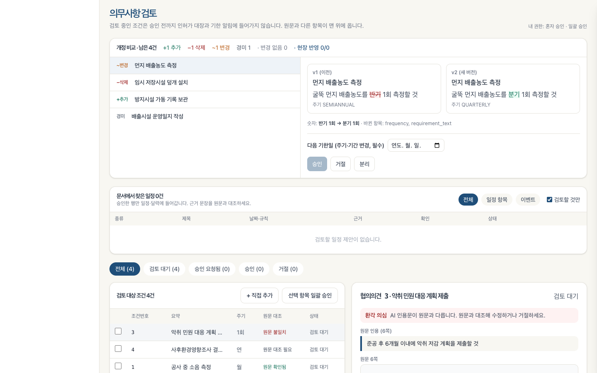

**법령 영향** — 직접 영향, 신구조문, 시행일 기한 등록

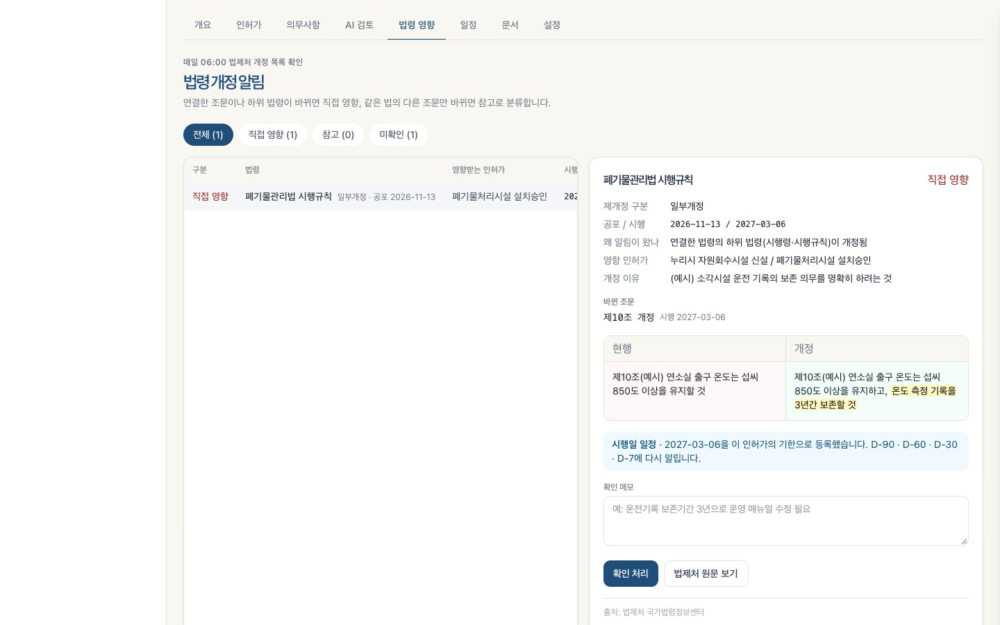

**일정 — 간트** — 분야 묶음, 선후행 선, 오늘 선, 기준 대비 지연

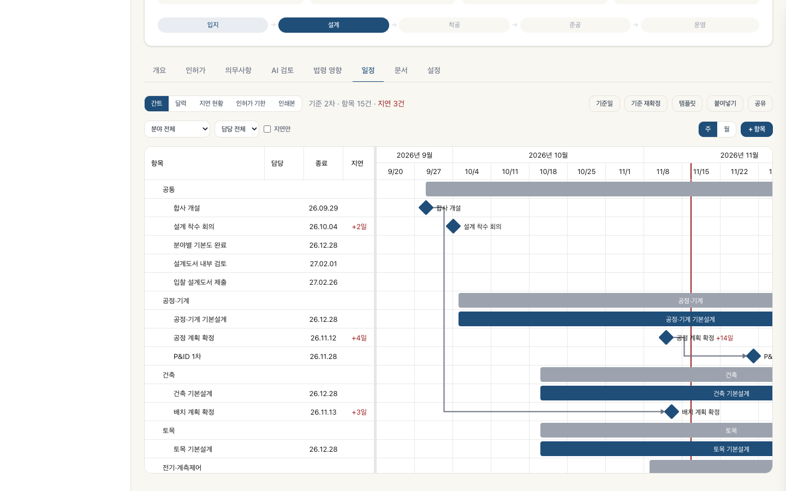

**일정 — 달력** — 마일스톤과 인허가 기한

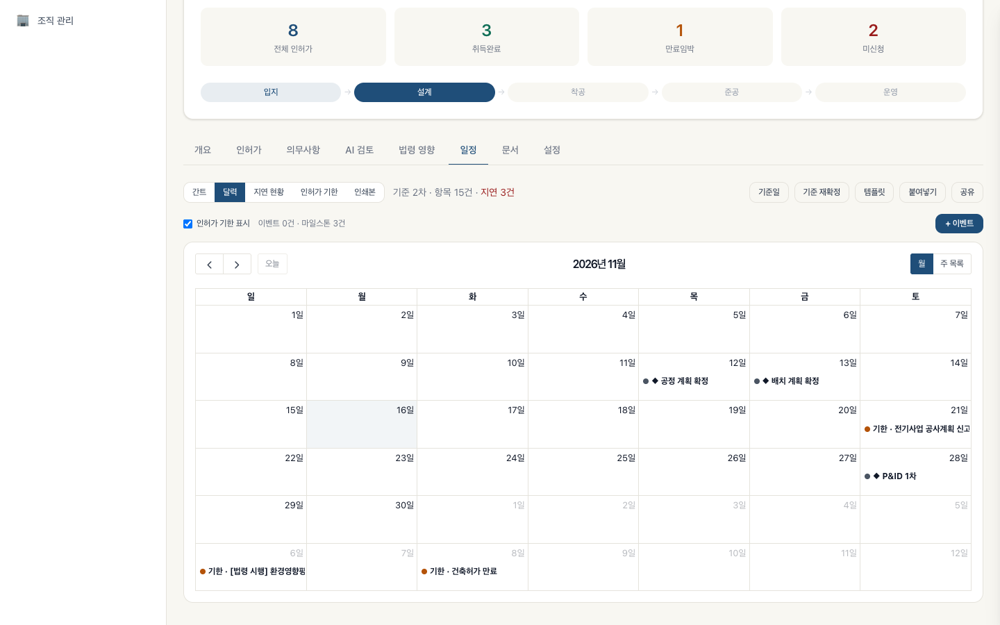

**일정 — 지연 현황** — 기준 대비 지연 일수, 연기 사유, 주간보고용 복사

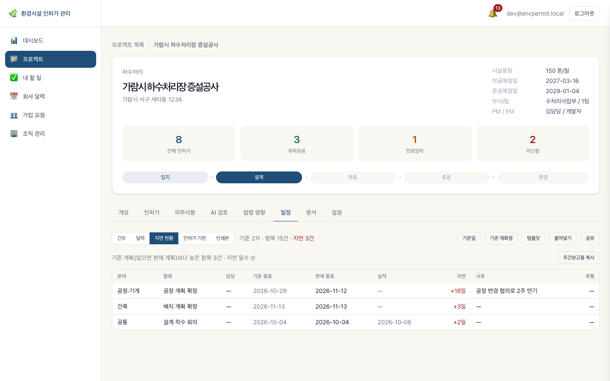

**내 할 일** — 기한 임박, 법령 개정 미확인, AI 검토 대기

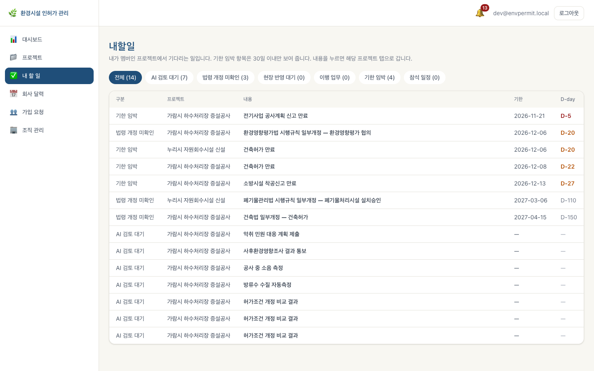

---

## 로컬 실행

### 준비
- Docker Desktop, Node.js 20+, Java 17(Docker 없이 백엔드를 돌리거나 테스트할 때)

### 1. 환경변수
```bash
cp .env.example .env
```
`.env`에서 `DB_PASSWORD`, `JWT_SECRET`(32바이트 이상, 예: `openssl rand -base64 48`), `S3_SECRET_KEY`를 채웁니다. 나머지는 선택입니다.

| 변수 | 비워 두면 |
|---|---|
| `LAW_API_OC` (법제처 Open API OC) | 법제처 검색만 503. 시드 법령 카탈로그·연결은 동작 |
| `EXTRACTION_PROVIDER`, `ANTHROPIC_API_KEY` / `GEMINI_API_KEY` / `OPENAI_API_KEY` | AI 추출 실행이 실패 메시지를 냄. 제공자를 비우면 키가 있는 쪽(Claude → Gemini → OpenAI 순) |
| `CLAUDE_MODEL` / `GEMINI_MODEL` / `OPENAI_MODEL` | 기본 `claude-sonnet-5-5` / `gemini-3.6-flash` / `gpt-6.1-terra` |
| `SMTP_*` | 메일을 보내지 않고 로그에만 남김 |

> ⚠️ AI 추출은 회사 설정에서 관리자가 켜야 실행되고, 실행 전 고지에 제공자 이름이 나옵니다. **Gemini 무료 등급은 입력을 Google 제품 개선에 쓸 수 있으니** 실제 회사 문서는 유료 등급에서만 보내세요([Gemini API 약관](https://ai.google.dev/gemini-api/terms)). Claude·OpenAI도 [Anthropic 약관](https://www.anthropic.com/legal)·[OpenAI 데이터 정책](https://openai.com/enterprise-privacy/)을 확인하세요. OpenAI 호출은 `store: false`로 보냅니다.

Gmail로 실제 메일을 보내려면 [2단계 인증](https://myaccount.google.com/signinoptions/two-step-verification)을 켜고 [앱 비밀번호](https://myaccount.google.com/apppasswords)를 만들어 `SMTP_HOST=smtp.gmail.com`, `SMTP_PORT=587`, `SMTP_USERNAME`, `SMTP_PASSWORD`에 넣습니다.

### 2. DB · 문서 저장소 · API (Docker Compose)
기본 포트는 DB 5432 / API 8080입니다. 다른 로컬 DB와 겹치지 않게 개발 중에는 아래처럼 DB 5435 / API 8081로 띄웁니다.
```bash
DB_PORT=5435 API_PORT=8081 docker compose up -d --build
```
PostgreSQL 16, S3 호환 저장소(SeaweedFS, 8333), API가 뜹니다. Flyway가 스키마를 만들고, API가 시작할 때 버킷을 만듭니다.

`SPRING_PROFILES_ACTIVE=dev`(기본)이면 가상의 회사·프로젝트·인허가와 개발용 계정이 생깁니다(운영 프로필에서는 만들지 않음).
계정 비밀번호는 `.env`의 `DEV_SEED_PASSWORD`입니다. 정하지 않으면 혼자 쓰는 로컬 설치용 기본값 `dev1234!`가 쓰입니다.
**여럿이 쓰거나 외부에 공개하는 실행(데모 포함)에서는 반드시 `DEV_SEED_PASSWORD`를 새 값으로 정하고 DB를 처음 만들기 전에 넣으세요.**
이 값은 계정이 처음 생길 때만 쓰입니다. 이미 있는 계정의 비밀번호는 바꾸지 않습니다.

| 계정 | 역할 |
|---|---|
| `dev@envpermit.local` | A사 회사 관리자, 예시 프로젝트 4개의 프로젝트 관리자(승인·일괄 승인 권한) |
| `kim@envpermit.local` | A사, 프로젝트 1의 일반 멤버(승인 권한 없음 → 승인 요청만) |
| `other@envpermit.local` | B사. A사 프로젝트 API는 403 |
| `demo@envpermit.local` | 공개 데모용(`DEMO_USER_ENABLED=true`일 때만 생김, 비밀번호 `demo1234!`). `dev@`의 프로젝트를 조회만 할 수 있고 쓰기 요청은 403 |

### 3. 웹
```bash
cd frontend
npm install
API_URL=http://localhost:8081 npm run dev -- --port 5182
```
`http://localhost:5182`에서 위 계정으로 로그인합니다. `/api` 요청은 Vite가 `API_URL`(기본 `http://localhost:8080`)로 넘깁니다. 메일 속 링크는 `APP_BASE_URL`(기본 `http://localhost:5182`)을 씁니다.

### 백엔드만 Docker 없이
```bash
docker compose up -d db s3
cd backend
set -a; . ../.env; set +a
S3_ENDPOINT=http://localhost:8333 ./gradlew bootRun
```
DB 포트를 바꿨다면 `DB_URL=jdbc:postgresql://localhost:5435/envpermit`도 줍니다.

---

## 기술 스택

| 구분 | 기술 |
|---|---|
| Backend | Java 17, Spring Boot 3, Spring Security(JWT, OAuth2 Resource Server), Spring Mail, Spring Data JPA, Flyway |
| Database | PostgreSQL 16 |
| 파일 저장 | S3 호환 저장소 (로컬 SeaweedFS, AWS SDK v2) |
| Frontend | React 18, TypeScript, Vite, Tailwind CSS 4, 간트: [SVAR React Gantt](https://svar.dev/react/gantt/) 2.8.2 (MIT) |
| AI | Claude(anthropic-java SDK) / Gemini / OpenAI 중 서버당 하나 — PDF 입력 + JSON 스키마 구조화 출력. PDFBox(글자층 확인·원문 대조), Apache POI(XLSX) |
| 외부 데이터 | [법제처 국가법령정보 Open API](https://open.law.go.kr/LSO/openApi/guideList.do) — 개정 목록, 조문, 신구조문 |
| 인프라 | Docker Compose. 공개 데모는 클라우드 서버 1대 + Cloudflare Tunnel(`deploy/oracle`) |
| 테스트 | JUnit 5, Testcontainers(PostgreSQL), 녹화한 외부 API 응답 픽스처(JDK `HttpServer` 대역) |

---

## 테스트

```bash
cd backend && ./gradlew test     # Docker가 켜져 있어야 함
```
2026-11-20 `dev`(#88) 기준 940개 중 937개 통과, 실패 0, 건너뜀 3(실제 API 녹화용 2개 + 레포 밖 골든 사례 1개).

| 방식 | 내용 |
|---|---|
| **REST + Testcontainers (주 seam)** | 대부분의 테스트는 실제 PostgreSQL 16 컨테이너 위에서 HTTP API를 호출해 응답·DB 상태를 봅니다. 권한(타 회사 403, 비멤버 403), 트랜잭션, 낙관적 락 409, append-only 감사 트리거까지 실제 DB로 확인합니다. 문서 저장소만 메모리 가짜로 바꿉니다 |
| **순수 함수 표 테스트** | 규칙 평가(참/거짓/모름), 버전 비교 판정, 영향 판정, 일정 상태·지연 계산, 조건번호 정규화 같은 결정적 로직은 경계값 표로 고정합니다(예: `RuleSeedTest` 규칙별 128행) |
| **외부 API는 녹화 응답** | 법제처 응답은 실제 호출을 녹화한 픽스처 파일(키 제거 확인 테스트 포함), Gemini·OpenAI는 실제 응답을 녹화해 로컬 대역 서버로 재생합니다. CI에서 외부 호출·비용이 없습니다. Claude 어댑터는 손으로 만든 응답 + 실제 호출 3건으로 확인했습니다 |
| **골든 하네스 (자동 도출)** | 규칙 세트를 실제 사업의 인허가 목록과 대조해 재현율·정밀도·보류를 잽니다. 저장소에는 지어낸 사례만 있고, 실제 사례는 `GOLDEN_DIR`이 가리키는 레포 밖 폴더에서만 읽습니다 → [golden-accuracy.md](docs/golden-accuracy.md) |
| **추출 품질 평가 (수동)** | 공개 협의내용 문서와 정답표로 3사 추출 재현율·정밀도를 잽니다. 비용이 들어 CI에서는 돌지 않습니다 → [방법](docs/EXTRACTION_EVAL.md), [결과](docs/EXTRACTION_EVAL_RESULTS.md) |

프론트엔드는 Vitest 단위 테스트(`cd frontend && npm test`)가 있습니다.
CI는 PR마다 타입 검사(`tsc`), ESLint, Vitest, `vite build`를 돌립니다. 화면 동작은 브라우저로 확인합니다.

---

## 문서

- [아키텍처](docs/ARCHITECTURE.md) — 모듈, AI 제안 + 사람 검토 통로, 법령 배치, 권한, 기밀 처리, 주요 결정
- [포트폴리오](docs/PORTFOLIO.md) — 기능별 문제·해결·실측 성과
- [시연용 가상 문서 4종](docs/samples/README.md) — 입찰공고, 허가서 v1·v2, 협의의견서 PDF. 내려받아 직접 올려 볼 수 있습니다
- [자동 도출 골든 측정](docs/golden-accuracy.md) · [추출 품질 평가 방법](docs/EXTRACTION_EVAL.md) · [추출 품질 실측 결과](docs/EXTRACTION_EVAL_RESULTS.md)

---

## 로드맵

✅ 구현(테스트 있음) · 🟡 진행 중·부분 · ⏳ 미구현. 괄호는 `dev`에 병합된 PR.

| 영역 | 상태 |
|---|---|
| 앱 뼈대: 인증, 회사·프로젝트·멤버 권한, 인허가 CRUD, 문서 첨부, 기한 알림, 회원가입·SMTP | ✅ (#4–#7, #22, #28) |
| 사람 검토 통로 + 허가조건 AI 추출, 스캔본 원문 열람 승인, 일괄 승인, 3사 어댑터 | ✅ (#9, #12, #13, #18, #20) · ⏳ 스캔본 OCR |
| 추출 품질 측정 (공개 문서 2건, 3사) | 🟡 (#43, #45, #52) 정답표 규칙 기반 2차 검토(Claude) + 경계 행 9개 실무자 판정, 문서당 1회 |
| 법령 카탈로그, 매일 개정 감지, 영향 판정, 의무–법령 자동 연결 | ✅ (#8, #10, #14, #15) |
| 인허가 자동 도출: 규칙 엔진, 판정 승인, 재실행, 규칙 14 → 34 → 48 → 51개 | ✅ (#11, #16, #46, #47, #61) · ⏳ AI 규칙 초안, 규칙 관리자 승인 |
| 자동 도출 골든 하네스 | 🟡 (#41) 실제 사례 1건, 회귀 게이트 없음 |
| 허가증 버전 비교, 현장 반영 추적 | ✅ (#17, #19, #21) |
| 프로젝트 중심 화면, 부서·팀, 내 할 일, 대시보드 | ✅ (#23, #25–#27, #29, #31) |
| 통합 QA (브라우저 전 구간, 타 회사 접근 점검) | ✅ (#48) |
| 운영단계 선택 모듈 (기본 꺼짐) | ✅ (#32–#35, #37–#40, #42, #49) |
| **분야별 설계 일정** 01 운영 모듈 선택화 · 02 분야·일정 항목·간트 · 03 기준일·오프셋, 기준 확정, 지연 현황 · 04 이벤트·출장 달력 · 05 협력사 읽기 전용 공유 · 06 Google 캘린더 단방향 동기화 · 07 문서 → 일정 제안(AI + 사람 검토) · 08 인허가 진행 현황 보고 1쪽 | ✅ (#49, #50, #53–#59) · ⏳ 실제 Google 연결 확인, 별도 세트로 AI 일정 추출 측정 |
| CI (GitHub Actions), 배포 | ✅ PR마다 백엔드 테스트·프론트 검사, 공개 데모 서버(`deploy/oracle`) |

---

## License

[MIT](./LICENSE)
