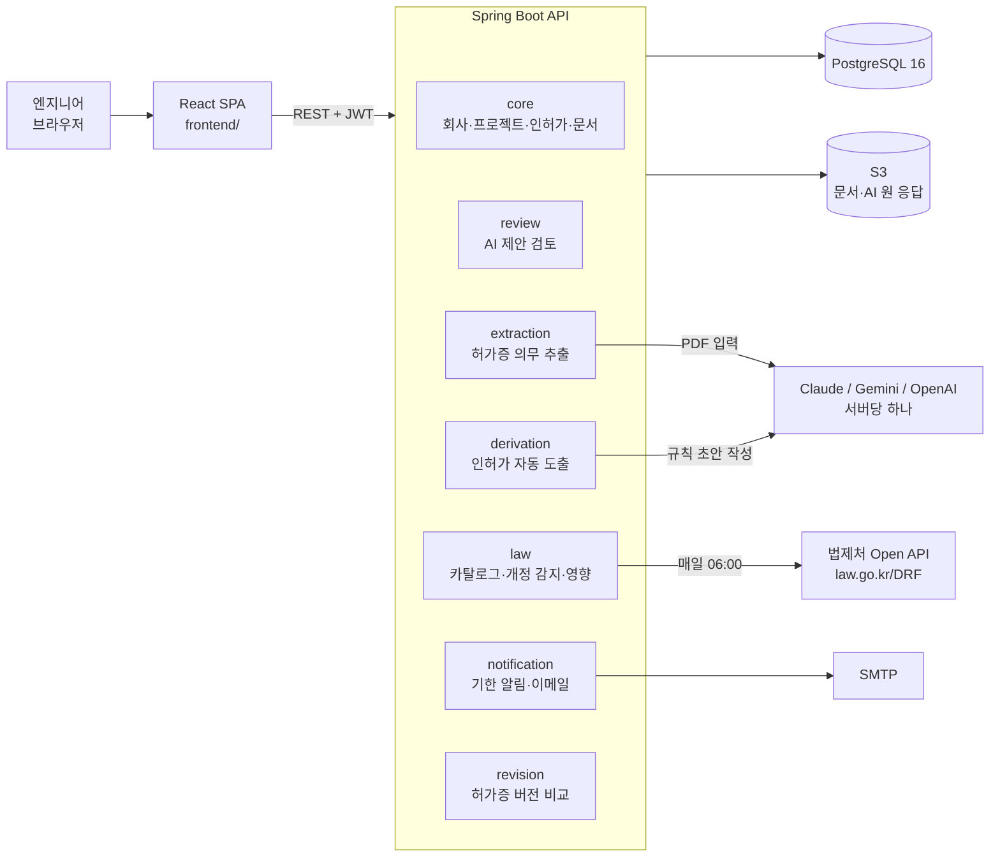
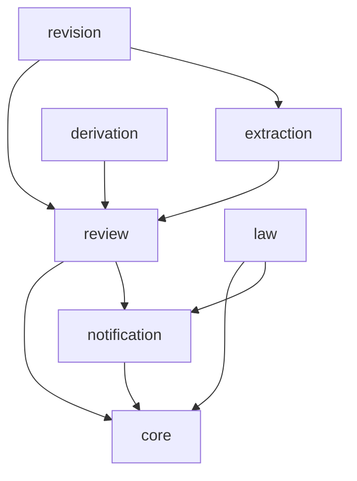
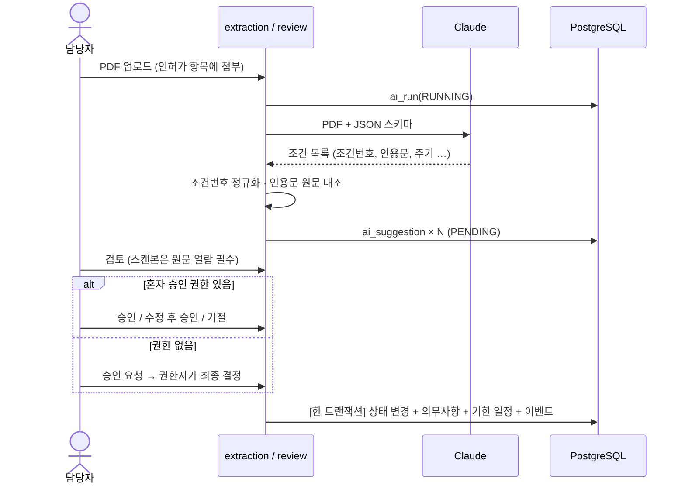
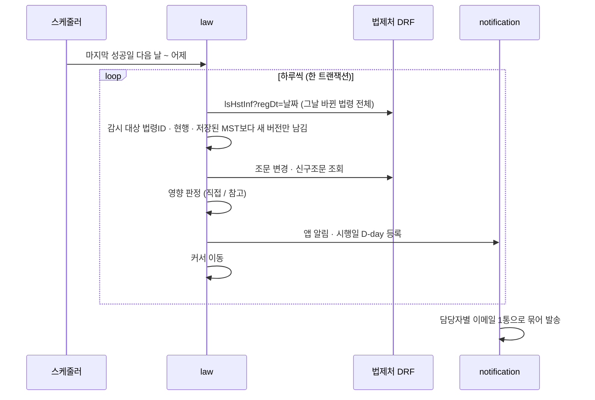
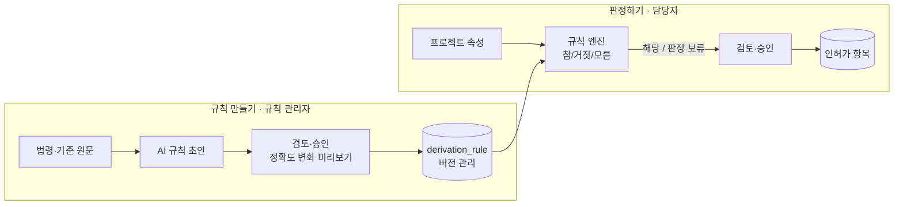
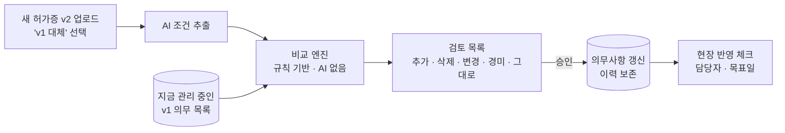
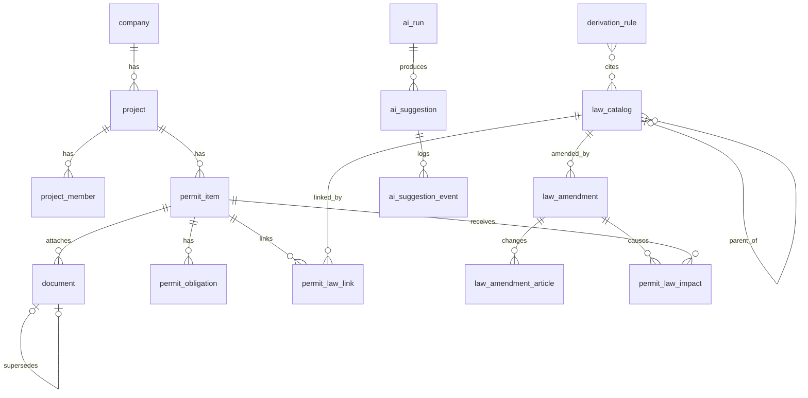

# 아키텍처

환경기초시설 인허가 관리 시스템의 전체 구조입니다. 아래 설계 중 대부분은 구현됐고, 일부(정확도 평가, AI 규칙 초안, OCR, 이메일 발송, 배포)는 아직입니다. 상태는 맨 아래 [구현 현황](#8-구현-현황)에 정리했습니다.

## 1. 설계 원칙

| 원칙 | 의미 | 어디서 지키나 |
|---|---|---|
| **AI는 제안만, 반영은 사람이** | AI 출력은 검토 대기 테이블에만 들어갑니다. 승인 트랜잭션만 실제 데이터(인허가 대장, 의무사항, 알림)에 쓸 수 있습니다 | `review` 모듈의 `ai_suggestion` + Applier |
| **판정은 결정적으로** | "이 인허가가 필요한가"는 규칙표로 계산합니다. 같은 입력이면 항상 같은 결과가 나오고, 정답셋으로 정확도를 매번 잴 수 있습니다. AI는 규칙 초안을 쓰는 데만 씁니다 | `derivation` 모듈 |
| **모든 결론에 근거** | 의무사항은 원문 조건번호와 인용문을, 판정은 "용량 300 ≥ 100" 같은 사유와 법령 ID를 함께 저장합니다 | `citation_key`, `source_quote`, `law_refs` |
| **모르면 모른다고** | 판정에 필요한 값이 없으면 추정하지 않고 "판정 보류"로 표시합니다. 이때 필요한 정보가 무엇인지 함께 보여 줍니다 | 3값 평가(참/거짓/모름) |
| **놓치지 않는 쪽으로** | 알림 누락이 가장 큰 실패라고 봅니다. 하위 법령 개정은 직접 영향으로 분류하고, 배치가 실패하면 밀린 날짜를 따라잡습니다. 의무 삭제도 결재를 거칩니다 | `amendment`, `revision` |

## 2. 시스템 구성

- 서버는 **한 대**를 전제로 합니다. 스케줄러는 Spring `@Scheduled`를 쓰고, 서버를 늘리면 ShedLock을 붙입니다.
- 외부로 나가는 데이터는 두 종류입니다. 허가 문서(설정한 AI 제공자)와 법령명 조회(법제처)입니다. 허가 문서 전송은 회사 단위 동의 설정(`ai_extraction_enabled`)이 켜져 있을 때만 일어납니다.

## 3. 백엔드 모듈

패키지 단위로 나눕니다. 화살표는 의존 방향입니다.

| 모듈 | 하는 일 | 주요 테이블 |
|---|---|---|
| `core` | 회사, 프로젝트, 멤버 권한, 인허가 항목, 문서(S3) CRUD | `company`, `project`, `project_member`, `permit_item`, `document` |
| `review` | AI 실행 기록, 검토 대기, 상태 전이, 감사 로그. kind별 **Applier**가 승인된 제안을 실제 데이터로 옮김 | `ai_run`, `ai_suggestion`, `ai_suggestion_event` |
| `extraction` | 허가증·협의의견서 PDF → 의무사항 제안. 입력 준비 단계는 교체 가능(Claude PDF 직접 / OCR) | `permit_obligation` |
| `derivation` | 프로젝트 속성 → 필요한 인허가 판정. 규칙표 평가 엔진 + AI 규칙 초안 + 정답셋 평가 | `derivation_rule`, `golden_case`, `golden_expected` |
| `law` | 법령 카탈로그, 인허가↔법령 연결, 일일 개정 감지 배치, 영향 판정 | `law_catalog`, `permit_law_link`, `law_amendment`, `law_amendment_article`, `permit_law_impact`, `batch_cursor` |
| `notification` | D-90/60/30/7 기한 알림, 앱 안 알림, 이메일 일일 요약 | `deadline_event`, `notification` |
| `revision` | 새 허가증 버전과 이전 버전의 조건 비교(추가/삭제/변경/경미) → 검토를 거쳐 의무사항 갱신, 현장 반영 추적 | `document.supersedes_document_id`, `permit_obligation_revision_log`, `revision_implementation` |

### 검토 파이프라인 확장 방식

AI가 만드는 결과는 모두 같은 통로를 지납니다. 기능을 추가할 때는 `kind` 하나와 Applier 하나만 더하면 됩니다.

| kind | 만드는 곳 | 승인하면 (Applier) | 승인 권한 |
|---|---|---|---|
| `OBLIGATION` | extraction | 의무사항 생성 + 기한 일정 + 법령 연결(`AI_EXTRACTED`) | 프로젝트 멤버 `can_self_approve` |
| `PERMIT_ITEM` | derivation | 인허가 항목 생성 + 법령 연결(`DERIVED`) | 프로젝트 멤버 `can_self_approve` |
| `DERIVATION_RULE` | derivation | 규칙 새 버전 등록 → 정답셋 재평가 | 사용자 `is_rule_admin` (시스템 공용 규칙) |
| `OBLIGATION_REVISION` | revision | 같은 의무 갱신(이력 보존) / 추가 / 종료. 삭제는 "원문에 없음 확인" 필수, 일괄 승인 불가 | 프로젝트 멤버 `can_self_approve` |

## 4. 주요 흐름

### 4.1 허가증 의무사항 추출 → 검토 → 기한 알림

- 인용문 대조 결과는 세 가지입니다. `VERIFIED`(원문에 있음), `MISMATCH`(환각 의심, 목록 맨 위), `UNVERIFIABLE`(스캔본, 사람이 페이지를 보고 확인).
- 같은 제안을 두 사람이 동시에 승인하면 낙관적 락으로 늦은 쪽이 409를 받습니다.

### 4.2 법령 개정 감지 (매일 06:00)

- **감시 대상**은 진행 중인 인허가가 연결한 법령과 그 시행령·시행규칙입니다. 변경 목록은 감시 법령 수와 상관없이 날짜 단위로 받습니다(실측 하루 1~612건, 100건씩 최대 7번 호출).
- 실제 API로 확인한 결과, 그날 목록에는 **과거 버전(연혁)도 섞여 나옵니다.** 그래서 "현행이고, 저장된 마지막 버전보다 새로운 것"만 개정으로 처리합니다.
- **직접 영향**: 조문을 지정하지 않음 / 지정한 조문이 바뀜 / 하위 법령이 바뀜. **참고**: 같은 법의 다른 조문만 바뀜.
- 실패하면 커서가 그 날짜에 멈추고, 다음 실행 때 거기서부터 다시 처리합니다(한 번에 최대 31일).

### 4.3 인허가 자동 도출과 AI 규칙 작성

- 규칙 조건은 `all` / `any` / 비교식으로 이루어진 JSON입니다. 예: "용량 ≥ 100 **또는** (경기도 **이고** 용량 ≥ 50)".
- 값이 없어서 "모름"이 된 규칙은 **판정 보류**로 나갑니다. 화면에는 "부지면적 → 2건 판정 대기"처럼 필요한 정보별로 묶어 보여 줍니다.
- 규칙이 바뀔 때마다 정답셋(실제 프로젝트의 인허가 목록, 비공개)으로 재현율과 정밀도를 다시 잽니다. CI에서도 돌립니다.

### 4.4 허가증 버전 비교

- **짝 맞추기:** 조건번호로 먼저 맞추고, 문장 유사도로 한 번 더 확인합니다. 번호가 밀렸거나 번호가 없으면 비슷한 문장끼리 짝을 제안하고, 사람이 확정합니다.
- **판정:** 숫자·단위·이상/이하·주기가 하나라도 다르면 **변경**, 말투만 다르면 **경미**(한 번에 승인)입니다. "50 → 30ppm"처럼 글자가 거의 같아도 놓치지 않습니다.
- **변경 승인:** 같은 의무를 고쳐 쓰므로 지난 이행 기록이 그대로 이어집니다. 주기가 바뀌면 다음 기한을 반드시 입력합니다.
- **삭제 승인:** AI가 놓친 조건이 삭제로 보일 수 있어서, "원문에 없음을 확인함" 체크가 필수이고 일괄 승인할 수 없습니다.
- 승인(대장 반영)과 **현장 반영**(운전 설정·계약 변경)은 따로 추적합니다. 기한이 없는 운영기준 변경도 놓치지 않게 하기 위해서입니다.

## 5. 데이터 모델 (핵심)

| 키 | 설명 |
|---|---|
| `permit_obligation.citation_key` | 문서 조건번호의 정규화 값(예: `협의의견 3-2항` → `3-2`). 서버 코드가 계산하며, 버전 비교의 매칭 키 |
| `permit_law_link.source` | `MANUAL` / `AI_EXTRACTED` / `DERIVED`. 누가 연결했는지 |
| `law_catalog.law_id` / `last_mst` | 법령ID는 개정돼도 같고, MST는 개정판마다 다름. MST로 같은 개정을 두 번 알리지 않음 |
| `ai_suggestion.payload` / `edited_payload` | AI 원본은 바꾸지 않고, 검토자 수정본을 따로 저장해 차이를 감사에 남김 |

## 6. 프론트엔드

`frontend/`는 React 18 + TypeScript + Tailwind + Vite입니다. 모든 화면이 실제 API를 씁니다. 예외: 대시보드의 상태 분포 차트·최근 활동은 아직 mock 상수이고, 프로젝트 상세의 "인허가 추가" 버튼은 연결되지 않았습니다.

| 경로 | 화면 | 연결될 모듈 |
|---|---|---|
| `/dashboard` | 인허가 현황, 만료 임박 | core, notification |
| `/projects`, `/projects/:id` | 프로젝트 목록·상세, 분야별 인허가 대장 | core, law |
| `/projects/new` | 속성 입력 → 자동 도출(판정 보류 포함) | derivation, review |
| `/calendar` | 인허가 일정 | notification |
| `/review` | AI 추출 조건 검토 (권한별 버튼, 스캔본 원문 열람) | review, extraction |
| `/laws` | 법령 개정 알림, 신구조문, 확인 메모 | law |

## 7. 보안과 운영

- **비밀값**: 법제처 OC 키(`LAW_API_OC`), Claude API 키, DB·S3 자격증명은 환경변수로만 주입합니다. 코드와 저장소에는 넣지 않습니다.
- **권한**: 모든 API는 프로젝트 멤버십을 확인합니다. 승인 권한은 직급명이 아니라 멤버별 플래그로 줍니다.
- **감사**: `ai_suggestion_event`는 추가만 가능하고, DB 권한으로 수정·삭제를 막습니다. AI 원 응답은 S3에 보관합니다.
- **출처 표기**: 법령 데이터를 보여 주는 화면과 이메일에 "출처: 법제처 국가법령정보센터"를 표시합니다(이용 조건).
- **외부 장애**: 법제처 API가 이틀 연속 실패하면 관리자에게 알립니다. LLM 호출이 실패하면 한 번 재시도하고, 그래도 안 되면 실행을 실패로 남기고 "다시 실행" 버튼을 보여 줍니다.

## 8. 구현 현황

2026-11-10 `dev` 기준. ✅ 구현(테스트 있음) · 🟡 부분 · ⏳ 미구현. 괄호는 병합된 PR 번호, 테스트는 `backend/src/test/java/com/envpermit/` 아래입니다.

| 영역 | 구현 | 설계와 다르거나 빠진 것 | 테스트 |
|---|---|---|---|
| 앱 뼈대: 인증(JWT), 회사·프로젝트·멤버 권한, 인허가 CRUD·상태 이력 (#4, #5) | ✅ | 화면에 인허가 추가·수정 폼 없음(API만) | `core/auth`, `core/project` |
| 문서 첨부, S3 호환 저장소 (#7) | ✅ | — | `core/document` |
| `notification` 기한 알림 D-90/60/30/7, 앱 알림, 캘린더 (#6) | 🟡 | 이메일은 `LogMailer`가 로그로만 남김(SMTP 없음) | `notification` |
| `review` 검토 통로, 상태 전이, 감사 로그(추가 전용 트리거), 일괄 승인 (#9, #13) | ✅ | kind는 `OBLIGATION`, `PERMIT_ITEM`, `OBLIGATION_REVISION` 3개. `DERIVATION_RULE` 없음 | `review` |
| `extraction` 텍스트 PDF 추출, 인용문 대조, 스캔본 원문 페이지 열람 (#12, #13) | 🟡 | OCR 입력 준비 단계 없음(스캔본은 `UNVERIFIABLE` + 사람이 페이지 확인) | `extraction` |
| 추출 제공자 Claude / Gemini / OpenAI (#18, #20) | ✅ | Gemini·OpenAI는 실제 API 응답을 녹화해 테스트. Claude 응답 픽스처는 손으로 만든 것(실제 호출 미검증) | `extraction/*ClientTest`, `ProviderTest` |
| `law` 카탈로그, 인허가↔법령 연결, 법제처 검색 (#8) | ✅ | — | `law/LawApiTest`, `LawApiClientTest` |
| `law` 매일 개정 감지 배치, 영향 판정, 개정 알림 화면, 2회 연속 실패 시 관리자 알림 (#10, #14) | ✅ | 테스트는 법제처 응답 픽스처로 실행. 개정 이메일 요약도 로그로만 | `law/AmendmentBatchTest`, `ImpactRuleTest`, `LawImpactApiTest` |
| 의무사항 승인 시 근거 법령 자동 연결 (#15) | ✅ | — | `obligation/ObligationLawLinkApiTest`, `law/LegalBasisTest` |
| `derivation` 규칙 엔진(참/거짓/모름), 판정 보류, 판정 승인·법령 연결·재실행 (#11, #16) | 🟡 | 규칙은 시드 SQL로만 넣음. AI 규칙 초안, 규칙 관리자(`is_rule_admin`) 승인 없음 | `derivation` |
| 정답셋 정확도 평가 (§4.3, `golden_case`·`golden_expected`) | ⏳ | 코드·테이블 없음. CI도 없음 | — |
| `revision` 버전 비교 엔진, 짝 조정, 승인, 현장 반영 추적 (#17, #19, #21) | ✅ | — | `revision/DiffEngineTest`, `extraction/RevisionApiTest`, `RevisionApplyApiTest` |
| 프론트엔드 | 🟡 | 대시보드 상태 분포 차트·최근 활동은 mock, 카카오 로그인 버튼은 동작 안 함 | — |
| 배포 (Docker → AWS EC2) | ⏳ | 로컬 `docker compose`만 있음 | — |

v2 후보: 입법예고 사전 경보, 자치법규(조례) 감시, 회사별 규칙 덮어쓰기, 지번으로 용도지역·지목 자동 조회, AI 보조 판정(규칙 밖 추가 검토 후보).
