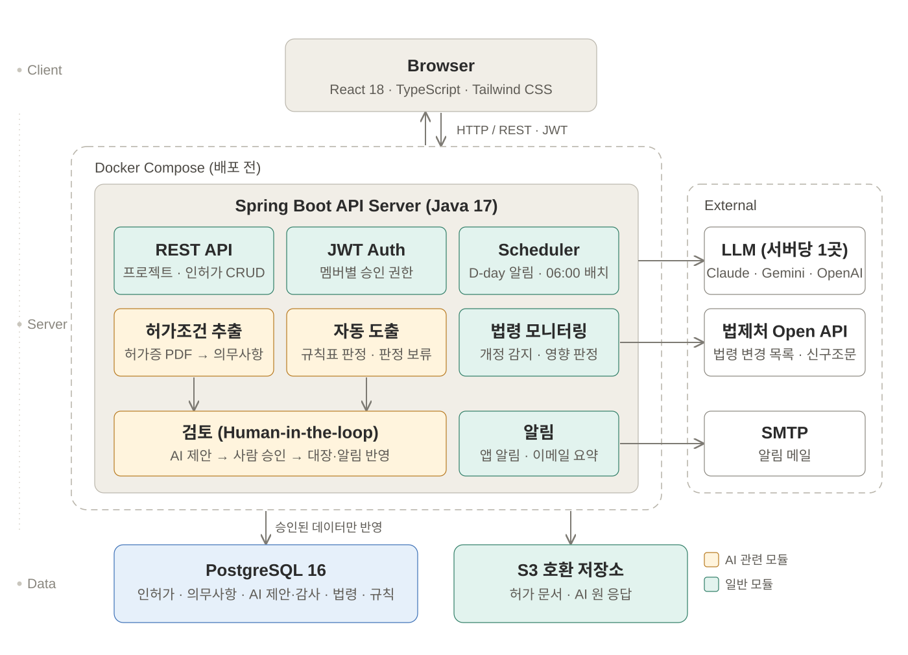
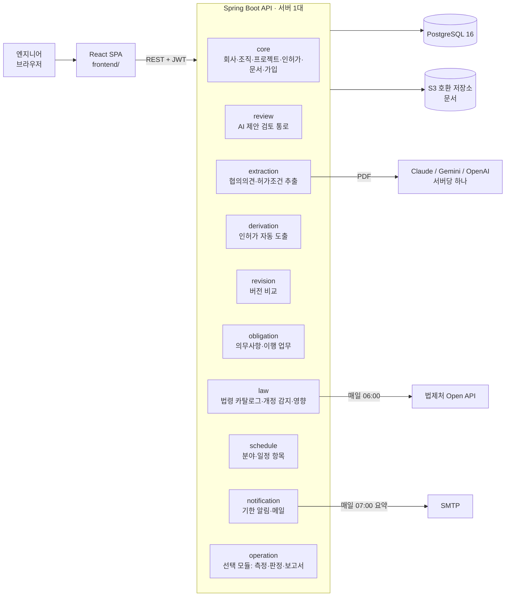
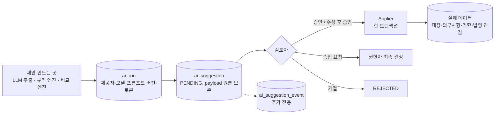
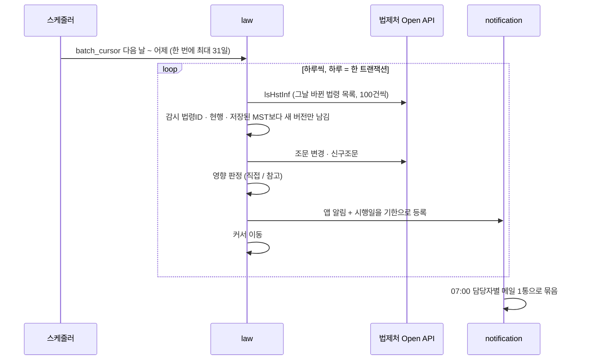
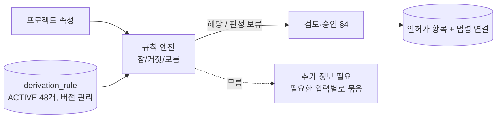
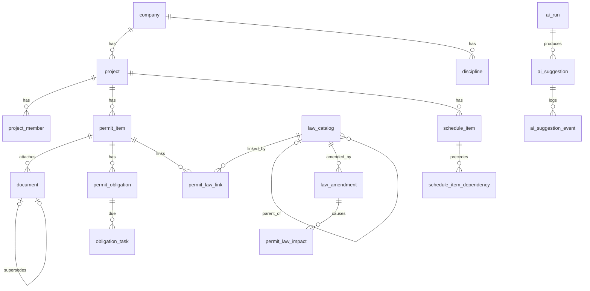

# 아키텍처

2026-11-15 `dev`(#50) 기준 구조입니다. 기능별 구현 상태는 [README 로드맵](../README.md#로드맵)에 있습니다.

## 1. 설계 원칙

| 원칙 | 의미 | 어디서 지키나 |
|---|---|---|
| **AI는 제안만, 반영은 사람이** | AI·규칙 엔진의 출력은 검토 대기 테이블에만 들어갑니다. 승인 트랜잭션만 실제 데이터(인허가 대장, 의무사항, 기한)에 씁니다 | `review` 모듈의 `ai_suggestion` + `SuggestionApplier` |
| **판정은 결정적으로** | "이 인허가가 필요한가"와 "이 조건이 바뀌었나"는 코드로 계산합니다. 같은 입력이면 같은 결과이고, 정답셋으로 반복해서 잴 수 있습니다 | `derivation`, `revision` |
| **모든 결론에 근거** | 의무사항은 원문 조건번호·인용문을, 판정은 "용량 300 ≥ 100" 같은 사유와 법령·조문을 함께 저장합니다 | `citation_key`, `source_quote`, `law_refs` |
| **모르면 모른다고** | 판정에 필요한 값이 없으면 추정하지 않고 "판정 보류"와 필요한 정보를 보여 줍니다 | 3값 평가(참/거짓/모름) |
| **놓치지 않는 쪽으로** | 알림 누락을 가장 큰 실패로 봅니다. 하위 법령 개정은 직접 영향, 배치 실패는 밀린 날짜부터 다시, 의무 삭제는 원문 확인 체크 필수 | `law`, `revision` |

## 2. 시스템 구성

> 그림은 2026-11-09에 그린 것으로, 2026-11-15에 글자만 고쳤습니다(배포 환경 → Docker Compose, LLM 3사, S3 호환 저장소). `obligation`·`schedule`·`operation` 모듈과 일정 알림은 그림에 없습니다. 아래 mermaid 그림이 현재 구조입니다.

- 서버 한 대를 전제로 Spring `@Scheduled`를 씁니다(법령 배치 06:00, 기한 알림 07:00, Asia/Seoul). 서버를 늘리면 ShedLock을 붙입니다.
- 회사 밖으로 나가는 데이터는 두 가지입니다. 허가 문서(설정한 LLM 제공자, 회사 설정 `ai_extraction_enabled`가 켜졌을 때만)와 법령 조회(법제처).

## 3. 백엔드 모듈

패키지 단위로 나눕니다(`backend/src/main/java/com/envpermit/`).

| 모듈 | 하는 일 | 주요 테이블 |
|---|---|---|
| `core` | 인증(JWT), 회사·부서·팀, 가입 신청·초대 코드, 프로젝트·멤버·PM/EM, 인허가 항목·상태 이력, 문서(S3, 형식·내용 검사, SHA-256) | `company`, `department`, `team`, `project`, `project_member`, `permit_item`, `permit_status_history`, `document`, `join_request` |
| `review` | AI 실행 기록, 제안 대기열, 상태 전이, 추가 전용 감사 로그. kind별 Applier가 승인된 제안을 실제 데이터로 옮김 | `ai_run`, `ai_suggestion`, `ai_suggestion_event` |
| `extraction` | 협의의견서·허가증 PDF → 의무사항 제안. 제공자 어댑터 3개(`LlmClient`), 조건번호 정규화(`CitationKey`), 인용문 원문 대조(`QuoteChecker`) | (`ai_suggestion`에 씀) |
| `derivation` | 프로젝트 속성 → 필요한 인허가. 필드 사전(`Fields`), 규칙 평가(`Evaluator`, 참/거짓/모름), 재실행 비교(`Rerun`) | `derivation_rule`, `ruleset_state` (판정 결과는 `ai_run`·`ai_suggestion`) |
| `revision` | 새 판과 이전 판의 조건 짝 맞추기·판정(`DiffEngine`, AI 없음) | `document.supersedes_document_id` |
| `obligation` | 승인된 의무사항, 회차별 이행 업무·증빙, 버전 반영(`RevisionApplier`), 현장 반영 추적 | `permit_obligation`, `permit_obligation_revision_log`, `obligation_task`, `task_evidence`, `task_event`, `revision_implementation` |
| `law` | 법령 카탈로그, 인허가↔법령 연결, 매일 개정 감지 배치, 영향 판정(`ImpactRule`) | `law_catalog`, `permit_law_link`, `law_amendment`, `law_amendment_article`, `permit_law_impact`, `batch_cursor` |
| `schedule` | 회사 공통 분야 목록, 프로젝트 일정 항목·마일스톤·FS 선후행, 상태·지연 계산(`ScheduleStatus`, 저장 안 함) | `discipline`, `schedule_item`, `schedule_item_dependency`, `schedule_item_event` |
| `notification` | 기한 등록(`Deadlines.register`), kind별 알림 시점(인허가 D-90/60/30/7, 일정 D-7/D-1, 기한 경과), 앱 알림, 사용자별 메일 요약 | `deadline_event`, `notification` |
| `operation` | **선택 모듈(프로젝트별, 기본 꺼짐).** 배출구·한도, 측정값 판정, 초과 시 조치 업무, 이행률, 이행 보고서 초안 | `pollutant`, `emission_point`, `permit_limit`, `measurement`, `project_module_event` |

모듈 사이 결합은 이벤트로 줄였습니다. 예: 멤버를 빼면 `MemberRemoved` 이벤트를 받은 `obligation`과 `schedule`이 그 사람의 열린 업무·항목을 미지정으로 돌립니다. 운영 모듈이 꺼진 프로젝트의 운영 API는 409 `MODULE_DISABLED`를 돌려줍니다.

## 4. 공통 뼈대: AI 제안 + 사람 검토

AI나 규칙 엔진이 만든 결과는 모두 같은 통로를 지납니다. 새 기능은 `Kind` 값 하나와 `SuggestionApplier` 하나만 더하면 검토 화면·권한·감사 로그·일괄 승인을 그대로 씁니다.

| kind | 만드는 곳 | 승인하면 | 상태 |
|---|---|---|---|
| `OBLIGATION` | extraction (LLM) | 의무사항 + 이행 업무 + 기한 + 근거 법령 연결(`AI_EXTRACTED`) | ✅ |
| `PERMIT_ITEM` | derivation (규칙 엔진) | 인허가 항목 + 법령 연결(`DERIVED`) | ✅ |
| `OBLIGATION_REVISION` | revision (비교 엔진) | 같은 의무를 고쳐 씀(이력 유지) / 추가 / 종료. 삭제는 "원문에 없음 확인" 필수, 일괄 승인 불가 | ✅ |
| `DERIVATION_RULE` | derivation (LLM이 법령 원문에서 규칙 초안) | 규칙 새 버전 → 골든 재평가 | ⏳ 설계만. 지금 규칙은 사람이 쓴 시드 SQL |
| 일정 제안 | 문서 → 일정(공고문·과업내용서의 날짜, 상대 기한은 "기준일 + 오프셋"으로) | 일정 항목 생성·갱신 | ⏳ 티켓 design-schedule/07 |

- 검토자 수정본은 `edited_payload`에 따로 두고 AI 원본은 바꾸지 않습니다. 차이가 감사에 남습니다.
- 인용문 대조 결과: `VERIFIED`(원문에 있음), `MISMATCH`(환각 의심, 목록 맨 위), `UNVERIFIABLE`(글자층 없는 스캔본 → 원문 페이지를 열어야 승인 버튼이 켜짐).
- 같은 제안을 두 사람이 동시에 승인하면 낙관적 락으로 늦은 쪽이 409. 멤버 확인을 버전 확인보다 먼저 해서 타 회사 사용자는 409가 아니라 403을 받습니다(#48).

## 5. 주요 흐름

### 5.1 법제처 개정 감지 배치 (매일 06:00)

- **감시 대상:** 진행 중인 인허가가 연결한 법령과 그 하위 법령(시행령·시행규칙).
- **법령마다가 아니라 날짜마다 조회:** 감시 법령이 늘어도 호출 수가 거의 같습니다.
- **연혁 행 걸러내기:** 실제 응답에는 그날 목록에 과거 버전이 섞여 나와서, "현행이고 저장된 MST보다 새 것"만 개정으로 봅니다. 법령ID는 개정돼도 같고 MST는 판마다 달라 같은 개정을 두 번 알리지 않습니다.
- **영향 판정:** 조문을 지정하지 않았거나 지정한 조문이 바뀌었거나 하위 법령이 바뀌면 직접 영향, 같은 법의 다른 조문만 바뀌면 참고.
- **실패:** 커서가 그 날짜에 멈추고 다음 실행 때 거기서 다시 합니다. 2회 연속 실패하면 관리자에게 알립니다.

### 5.2 협의의견·허가조건 추출

PDF 업로드 → `ai_run(RUNNING)` → 제공자에 PDF + JSON 스키마 → 조건번호 정규화·인용문 대조 → `ai_suggestion` × N → 검토(§4). 응답이 스키마에 맞지 않으면 1회 재시도하고, 그래도 실패하면 실행을 실패로 남기고 "다시 실행"을 보여 줍니다. Claude 어댑터는 출력 상한 64,000토큰 + 스트리밍입니다(16,000일 때 사고 토큰 때문에 잘리던 문제를 실측에서 찾아 고침, #45).

### 5.3 인허가 자동 도출

- 규칙 조건은 `all` / `any` / 비교식 JSON입니다. 기준값·조문은 법령 본문에서 확인해 규칙의 `source_ref`·`source_quote`에 적었습니다.
- 속성을 바꿔 재실행하면 이전 결과와 비교해 새로 해당 / 더 이상 해당 안 됨을 보여 줍니다.
- 정확도는 골든 하네스로 잽니다(§8, [golden-accuracy.md](golden-accuracy.md)).

### 5.4 허가증 버전 비교

조건번호(`citation_key`)로 먼저 짝을 맞추고 문장 2-gram 유사도로 확인합니다. 번호가 밀렸거나 없으면 비슷한 문장끼리 짝을 제안하고 사람이 확정합니다. 숫자·단위·이상/이하·주기가 하나라도 다르면 **변경**, 말투만 다르면 **경미**(한 번에 승인)입니다. 승인(대장 반영)과 현장 반영(운전 설정·계약 변경)은 따로 추적합니다.

### 5.5 분야별 설계 일정 (진행 중)

- 지금(#50): 회사 공통 분야 11개(회사 생성 시 복사), 일정 항목(묶음 › 항목 › 하위 1단계, 마일스톤), FS 선후행(순환 금지), 간트(SVAR React Gantt, MIT, 지연 로드). 상태·지연 일수는 조회 때 계산하고 저장하지 않습니다. 변경 이력은 추가 전용.
- 다음: 기준일 + 오프셋과 기준 계획 확정(03), 이벤트·출장 달력(04), 협력사 읽기 전용 링크(05), Google 캘린더 단방향(06), 문서 → 일정 제안(07, §4 통로 재사용), 인허가 진행 현황 1쪽(08).

## 6. 권한 모델

| 층 | 무엇으로 | 할 수 있는 것 |
|---|---|---|
| 회사 | `users.company_id`, `users.role = ADMIN` | 같은 회사 프로젝트 목록·개요 열람. 회사 관리자는 가입 승인, 초대 코드, 조직·분야 관리, AI 추출 켜기 |
| 프로젝트 멤버 | `project_member` | 탭 전체 읽기·쓰기. 비멤버는 개요·인허가만 보이고 나머지 API는 403 |
| 멤버 플래그 | `is_admin`, `can_self_approve`, `can_bulk_approve` | 프로젝트 관리(멤버·모듈), 혼자 승인(없으면 승인 요청만), 일괄 승인 |
| 프로젝트 역할 | PM·EM 지정 | 업무 기본 담당 순서(의무 기본 담당 → EM → PM), 운영 모듈 켜고 끄기 |

- 승인 권한은 직급명이 아니라 멤버별 플래그로 줍니다. 회사마다 결재 방식이 달라서입니다.
- 모든 API는 경로의 프로젝트 멤버십을 먼저 확인하고, 본문에 다른 회사·프로젝트 id가 섞이면 403/422입니다. #48에서 다른 회사 사용자와 같은 회사 비멤버로 모든 GET·쓰기 API를 돌려 데이터 노출이 없음을 확인했습니다(남은 것: 존재하지 않는 id는 404, 남의 id는 403이라 id 존재 여부는 구분 가능).

## 7. 데이터 모델 (핵심)

| 키 | 설명 |
|---|---|
| `permit_obligation.citation_key` | 조건번호 정규화 값(`협의의견 3-2항` → `3-2`). 서버 코드가 계산, 버전 비교의 짝 키 |
| `permit_law_link.source` | `MANUAL` / `AI_EXTRACTED` / `DERIVED`. 세 기능이 만든 연결이 모두 개정 감시 대상이 됨 |
| `law_catalog.law_id` / `last_mst` | 법령ID는 불변, MST는 판마다 다름 |
| `ai_suggestion.payload` / `edited_payload` | AI 원본과 검토자 수정본 분리 |
| `*_event` 테이블 | `ai_suggestion_event`, `task_event`, `schedule_item_event`는 DB 트리거로 UPDATE·DELETE를 막는 추가 전용 |

## 8. 기밀 데이터 처리

저장소는 공개이고, 실제 회사 문서·사업 데이터는 대외비입니다.

- **저장소에는 가상 데이터만:** 개발 시드의 회사·프로젝트·지명·인물은 지어낸 이름입니다(#44에서 실제 지명 예시를 교체). 규칙의 근거는 공개 법령 조문만 적습니다(`V280__anonymize_rule_source_ref.sql`).
- **골든 데이터는 레포 밖:** 실제 사업의 속성·인허가 목록은 환경변수 `GOLDEN_DIR`이 가리키는 레포 밖 폴더에서만 읽고, 사례별 결과도 그 폴더에만 씁니다. 없으면 해당 테스트는 건너뛰고 지어낸 사례(`golden/cases/synthetic-incineration.json`)만 돕니다. PR에는 집계 숫자만 올립니다.
- **추출 평가 자료도 레포 밖:** 평가 문서·정답표·응답 원문은 저장소 밖 평가 폴더에 두고, 결과 문서에는 집계 수치만 씁니다. 지금까지 쓴 문서는 공개된 환경영향평가 협의내용입니다.
- **비밀값은 환경변수로만:** DB·JWT·S3·법제처 OC·LLM 키. 녹화한 법제처 응답에 키가 없는지 테스트로 확인합니다.
- **AI 전송은 회사 동의 후:** 회사 설정을 켜야 문서가 LLM으로 나가고, 실행 전 고지에 제공자가 나옵니다. OpenAI는 `store: false`.

## 9. 주요 결정

| 결정 | 이유 |
|---|---|
| 인허가 판정은 LLM이 아니라 규칙 엔진 | 같은 입력에 같은 결과가 나와야 정답셋으로 회귀를 잴 수 있고, 판정마다 법령 근거를 붙일 수 있음 |
| 3값 논리 + 판정 보류 | 입력이 없을 때 "해당 없음"으로 떨어지면 누락이 조용히 생김 |
| 모든 AI 출력은 하나의 검토 통로로 | 권한·감사·일괄 승인을 기능마다 다시 만들지 않고, 사람 승인 없는 반영을 구조적으로 막음 |
| 버전 비교는 AI 없는 결정적 엔진 | 숫자 하나 바뀐 조건("50 → 30ppm")을 유사도가 높다고 놓치면 안 됨 |
| 법제처는 날짜별 변경 목록 1회 조회 | 감시 법령 수에 비례하는 호출을 피하고, 커서로 장애 뒤 자동 복구 |
| LLM 제공자를 서버 설정으로 교체 가능 | 회사마다 허용하는 제공자·데이터 조건이 다르고, 같은 정답표로 비교할 수 있음 |
| 주 테스트 seam = REST + Testcontainers | 권한·트랜잭션·트리거는 실제 PostgreSQL에서만 제대로 확인됨 |
| 외부 API는 녹화 응답으로 테스트 | CI에서 비용·키·네트워크 없이 실제 응답 형태를 고정 |
| 실제 사례는 `GOLDEN_DIR`로 레포 밖 | 공개 저장소에서 대외비를 다루지 않으면서 실제 데이터로 측정 |
| 운영 기능은 프로젝트별 선택 모듈, 기본 꺼짐 | 측정·초과 판정은 운영사 업무이고 설계사 사용자의 화면을 복잡하게 함. 데이터는 지우지 않음 |
| 일정 지연은 저장하지 않고 조회 때 계산 | 저장값은 날짜가 지나면 틀려짐 |
| 간트는 MIT 라이브러리(SVAR) + 지연 로드 | 간트 UI는 직접 만들 가치가 낮음. 메인 번들 증가 gzip +4.1 kB |
| 서버 1대 + `@Scheduled` | 지금 규모에 분산 락은 불필요. 늘리면 ShedLock |

## 10. 프론트엔드

React 18 + TypeScript + Tailwind 4 + Vite. 모든 화면이 실제 API를 씁니다.

| 경로 | 화면 |
|---|---|
| `/dashboard` | 회사 현황, 기한 임박, 처리 대기 |
| `/projects` | 프로젝트 목록(정렬·필터, 부서·팀, PM·EM) |
| `/projects/new` | 속성 입력 → 인허가 자동 도출 |
| `/projects/:id/:tab` | 개요 · 인허가 · 의무사항 · AI 검토 · 법령 영향 · 일정(간트 / 인허가 기한) · 운영(켠 프로젝트만) · 문서 · 설정 |
| `/inbox` | 내 할 일(기한, 검토 대기, 법령 개정 미확인, 이행 업무). 옛 `/calendar`, `/review`, `/laws`는 여기로 이동 |
| `/org`, `/join-requests` | 회사 관리자: 부서·팀·분야, 가입 승인 |
| `/login`, `/signup`, `/join/:code` | 로그인, 새 회사 가입, 초대 코드 가입 |

## 11. 아직 없는 것

스캔본 OCR, AI 규칙 초안과 규칙 관리자 승인, 골든 회귀 게이트("직전 대비 재현율 하락 시 실패"), CI, 배포, 프론트엔드 테스트 러너, 설계 일정 티켓 03–08.

v2 후보: 입법예고 사전 경보, 자치법규(조례) 감시, 회사별 규칙 덮어쓰기, 지번으로 용도지역·지목 자동 조회.
